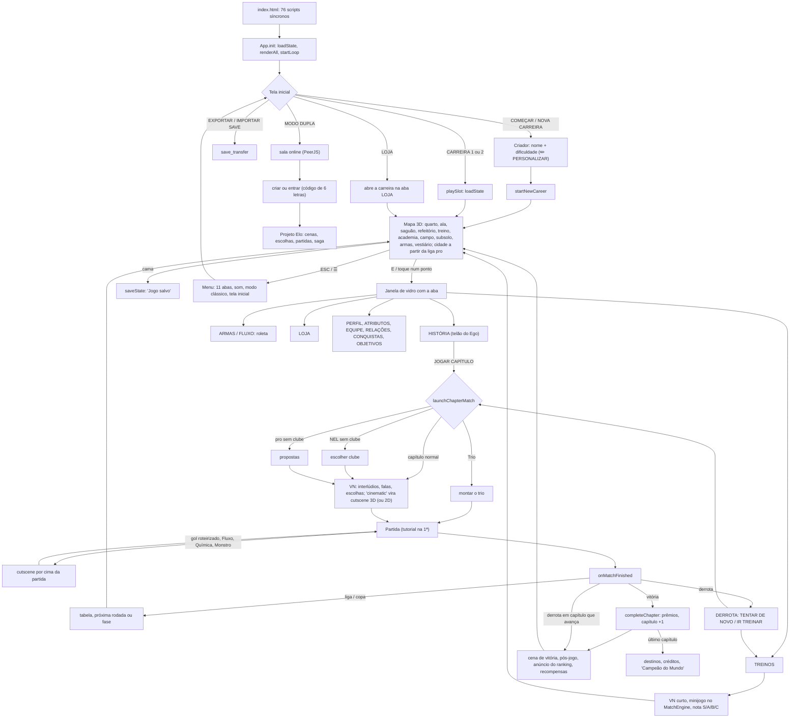

# AUDIT.md — FASE 0: AUDITORIA

Diagnóstico completo do jogo antes de mexer em qualquer coisa (seção 5 do `PROMPT_MESTRE_BLUE_LOCK.md`).

- **Data:** 12/11/2026
- **Versão auditada:** branch `sprites-2` no commit `e4ba51c`. É o `main` publicado (`2c0eced`) mais a cidade liberada depois da liga pro. Nenhum arquivo de código foi alterado nesta fase.
- **O que ficou de fora:** três trabalhos paralelos em cópias separadas que ainda não entraram no jogo (seção 13):
  - estádios gigantes;
  - cidade maior;
  - treinos novos.
- **Como foi feito:** seis frentes de auditoria em paralelo:
  - arquitetura, save e desempenho;
  - telas, UI, áudio e celular;
  - cutscenes 01–32;
  - cutscenes 33–63;
  - gameplay e balanceamento;
  - lore e texto.
- **Ferramentas:** o jogo foi aberto e jogado no Chrome controlado pelo DevTools, do mesmo jeito que o Playwright faria. Não há Node neste PC, e instalar o Playwright exigiria baixar pacotes. O harness ficou em `docs/auditoria/ferramentas/`.
- **Bot de balanceamento:** um bot que joga pelo próprio motor do jogo fez cerca de 560 partidas e 6 carreiras completas.
- **Medições de desempenho:** máquina i7-4770 com Intel HD 4600. O "celular emulado" usa 844×390, toque e CPU 4× mais lenta. Os números são pessimistas, porque havia outros Chromes abertos.
- **Relatórios completos** (com arquivo:linha de tudo): pasta `docs/auditoria/`. Este arquivo é o resumo que manda.

| Anexo | Conteúdo |
|---|---|
| `docs/auditoria/arquitetura_save_desempenho.md` | mapa de todos os arquivos, ordem de carregamento, estado/save, medições, 17 bugs, backlog |
| `docs/auditoria/telas_ui_audio_celular.md` | avaliação tela a tela, consistência visual, áudio, celular, 24 bugs, backlog |
| `docs/auditoria/cutscenes_01_32.md` e `cutscenes_33_63.md` | as 63 cenas plano a plano, repetições, efeito-assinatura de cada uma, backlog |
| `docs/auditoria/gameplay_balanceamento.md` | loops, fórmulas de cada atributo, curva medida, economia, 15 bugs, backlog |
| `docs/auditoria/lore_texto.md` | arcos jogo × mangá, contradições, 30 perguntas [VERIFICAR], texto e voz dos personagens, backlog |
| `docs/auditoria/ferramentas/` | harness do Chrome, captura das cutscenes e o bot de balanceamento |

**Screenshots** (pasta `audit_screens/`, fora do git):

| Pasta | Conteúdo |
|---|---|
| `audit_screens/telas/1366x768/` | 105 prints, do título até o fim da carreira |
| `audit_screens/telas/1920x1080/` | 21 prints |
| `audit_screens/telas/celular/` | 21 retrato e 21 paisagem |
| `audit_screens/cutscenes/` | 63 folhas de quadros: cada plano de cada cena, a 25% e a 75% da duração |
| `audit_screens/tecnico/` | o print da cena travada |

---

## 1. Resumo em 10 linhas

1. O jogo tem bastante coisa boa. O mapa 3D tem temas por fase e uma cidade. As janelas das abas são bonitas. O gol tem impacto de verdade. O tutorial da 1ª partida ensina jogando. A lore até a Sub-20 é bem pesquisada. E 8 cutscenes estão no nível que o dono quer.
2. **Dois bugs críticos.**
   - Uma cutscene congela no caminho normal da história (cap. 2b → cap. 3), e todas as seguintes ficam quebradas até apertar F5.
   - Qualquer erro ao carregar o save **troca a carreira por uma zerada e grava por cima**.
3. **O save é o ponto mais frágil.** Não tem versão, validação nem backup, e falhar ao gravar é silencioso.
4. **As cutscenes saíram quase todas do mesmo molde:** preto e branco azulado, cut-in de bola e chuteira, "DOM!!", câmera atrás da rede, "GOOOL!!", cartela. Resultado: 8 BOAS, 39 MÉDIAS, 16 RUINS. Há cenas no lugar errado ("Paris" no saguão do Blue Lock), vitórias que mostram a imagem da derrota, quadros 70–90% pretos e bonecos gigantes e cortados.
5. **O desempenho no celular é o maior risco para quem vai jogar.**
   - A tela inicial leva 18 s para abrir e o mapa roda a 7 fps.
   - Trocar de fase congela até 10 s.
   - A aba ARMAS leva até 3 s para abrir.
   - São poucos gargalos e bem localizados, então dá para ganhar muito com pouco.
6. **Perder não custa nada e ainda paga.** As finais da Sub-20 não podem ser perdidas, e o corte da NEL não corta ninguém. Não existe pressão de ranking nem eliminação. O Fácil não desafia, e o Egoísta é uma parede no começo.
7. **Os sistemas pesam pouco.** O OVR é decorativo para a dificuldade, a arma vem de roleta e pesa pouco, e escolhas e afinidade quase não mudam a partida. A carreira termina com cerca de 51 mil moedas e 156 giros sem uso.
8. **O visual não tem um sistema único.** São 5–6 estilos de componente, 6 famílias de fonte (Segoe UI só existe no Windows), 59 tamanhos de fonte e 81 emojis servindo de ícone.
9. **No áudio,** não há volume nem canais separados, e não toca música no título, no mapa nem na partida. O console mostra 8 erros de mp3 em toda abertura.
10. **Na lore,** a Copa Sub-20 se vende como "arco atual do mangá", mas contradiz o que já saiu. Há 30 itens [VERIFICAR] para o dono confirmar (seção 8).

---

## 2. Notas por área (0 a 10)

| Área | Nota | Justificativa curta |
|---|:-:|---|
| Visual geral e consistência | **6** | **Bom:** mapa 3D com temas, cidade e abas novas no nível de indie caprichado. **Ruim:** 5–6 estilos de componente convivendo, 6 fontes, 59 tamanhos, 311 cores no CSS e 81 emojis como ícone. Há sprite gigante no título, no VN e no mapa, reflexo fantasma no piso e números das costas invertidos. |
| Cutscenes | **5** | **Bom:** base técnica alta (3D com bonecos em pixel, câmera viva). **Ruim:** só 8 de 63 no nível das referências. O molde se repete em quase todas, 16 são ruins (lugar errado, momento-chave fora da tela, vitória = derrota, escuras) e há um bug que congela a cena. |
| UI e navegação | **6** | **Bom:** sempre há voltar (✕/ESC), as abas têm boa hierarquia e os pontos do mapa dizem o que fazem. **Ruim:** o mapa não mostra o próximo objetivo. ARMAS tem 15 telas de rolagem. Cabeçalhos cortam o texto, há rolagem lateral e dois modos de navegação concorrendo. |
| Game feel | **7** | **Bom:** o gol é forte (faixa, partículas, flash, tremida, hit-stop). A nota do treino e o gacha satisfazem. **Ruim:** fora da partida a UI é "muda": atributo subindo quase não se nota, a conquista é só texto e as transições são secas. Há números flutuando sobre os jogadores. |
| Profundidade de gameplay | **5** | **Bom:** a partida tem muitos verbos (drible em cadeia, fôlego, curva, carga, skills, 13 Fluxos com mecânica própria, Monstro) e é legível (% ao vivo). **Ruim:** armas são quase só números, escolhas não ramificam, afinidade não pesa em campo, OVR é decorativo e há finais com o placar roteirizado. |
| Progressão e balanceamento | **3,5** | **Bom:** atributos com efeito real e explicado. **Ruim:** não há risco (derrota paga; 12 de 21 capítulos não te param). Fácil e o meio do Normal não desafiam, Egoísta só cede com grind e a economia termina inflada. Há tetos escondidos (Velocidade 88, Poder 70). |
| Fidelidade à lore | **6** | **Bom:** prólogo até a Sub-20 está cuidadoso e acerta detalhes finos. **Ruim:** a Copa Sub-20 contradiz o que já saiu e se diz "arco atual". O Torneio de Trios parece inventado e é vendido como cânone. Há contradições internas (Kunigami, Top 6, nº 1) e pôsteres "ISAGI" num mundo sem Isagi. |
| Texto e narrativa | **6** | **Bom:** falas enxutas; Rin, Nagi e Fox com voz própria; cenas marcantes. **Ruim:** inglês na interface, personagens lendo o manual de controles, diálogo-placeholder no treino, tiques repetidos, escolhas ignoradas no epílogo, duas galas da Bola de Ouro e erros de digitação. |
| Áudio | **4** | **Bom:** efeitos sintetizados decentes na partida, trilhas próprias nas cenas, mudo salvo, nada toca antes do 1º clique. **Ruim:** sem canais e sem volume. Não há música no título, no mapa, no treino nem na partida. Faltam sons de hover, aviso, atributo e derrota. 8 erros de mp3 no console. |
| Performance | **4** | **Bom:** a partida no PC é leve (1,4 ms de desenho). **Ruim:** no PC o mapa fica entre 25 e 50 fps e só com a resolução no mínimo, e as cenas 3D ficam entre 10 e 25 fps, com o 1º quadro chegando a 5,8 s. No celular emulado: 18 s de abertura, 7 fps no mapa, até 10,7 s de congelamento ao trocar de fase. |
| Estabilidade e save | **4** | **Bom:** console quase limpo; partidas, mapa e cenas rodam sem exceção. **Ruim:** uma cena congela. O save não tem versão, validação nem backup. Um erro ao carregar zera a carreira e grava por cima, e saves estranhos travam a abertura. Falha ao gravar é silenciosa e duas abas se sobrescrevem. |
| Responsividade | **6** | **Bom:** trabalho real de celular (joystick e botões grandes, tamanho de tela e HUD). **Ruim:** a criação fica cortada na lateral com o celular em pé, há sobreposições e dicas de teclado no toque. O mapa em pé fica sem orientação, o HUD não cresce no 1920 e o jogador tem que girar o celular várias vezes no mesmo capítulo. |
| **Média** | **5,2** | |

---

## 3. Mapa do projeto

Detalhe completo, com tamanho e linhas de cada arquivo: `docs/auditoria/arquitetura_save_desempenho.md` §1.

**Totais**

- O `index.html` carrega **76 `<script>` síncronos**: cerca de 6,0 MB e 124 mil linhas de JS.
- São também **11 CSS** (443 KB).
- Não há build, `defer` nem carregamento sob demanda.

**Ordem de carregamento** (a ordem faz parte da lógica):

```
dados → áudio → bonecos → cutscene_engine/cine_kit → 22× cine_* (2D) → bg_* → match_engine → ego_fx
→ peerjs + duo_net/duo_match → app → save_transfer → duo_* → ui_shell → easter_eggs → mobile → ui_*
→ hub → hub3d → hub3d_cidade → hub3d_gl → cine3d → cine3d_kit → 15× cine3d_* (+ cine_art)
```

Arquivos de baixo **embrulham** funções dos de cima. Por exemplo, `App.renderTitleMenu` é embrulhado 4 vezes; `switchTab`, `CE.play` e `playActionSakuga` também são embrulhados. Trocar duas tags de lugar quebra o jogo sem erro claro.

| Subsistema | Arquivos principais | Observação |
|---|---|---|
| Estado e carreira | `app.js` (223 KB: estado, save, migrações, título, criador, 11 abas, loja, ligas, Copa, Trio, capítulos, treinos, conquistas), `save_transfer.js`, `easter_eggs.js` | o `App` faz quase tudo |
| Dados e textos | `data_story.js` (21 capítulos, 636 falas), `data_characters.js` (66 personagens), `data_weapons_flows.js`, `data_duo.js`, `data_animations.js` | há textos também em `app.js`, `easter_eggs.js`, `duo_saga.js` e dentro de cada cutscene |
| Bonecos | `pixel_renderer.js` (motor antigo), `sprite_rig.js` (Sprites 2.0), `sprite_bridge.js` | 2 motores ligados por uma ponte |
| Partida | `match_engine.js` (271 KB: partida, IA, controles, minijogo do treino, relatório), `ego_fx.js`, `mobile.js` | `match_gfx.js` está **morto** (não é carregado) |
| Mapa 3D | `hub.js` (base, HUD, mapa 2.5D de reserva), `hub3d.js` (`World`, áreas, raycasting de reserva), `hub3d_gl.js` (WebGL2), `hub3d_cidade.js` | 3 desenhadores para o mesmo mapa (2 de reserva) |
| Diálogo VN e fundos | `cutscene_engine.js` (309 KB), `bg_estadios.js`, `bg_bluelock.js`, `bg_mundo.js`, `cine3d.js` (VN filmado em 3D) | |
| Cutscenes 2D antigas | `cine_kit.js`, `cine_art.js` (usados também pelas 3D); 17 `cine_*` com versão 3D (cerca de 1,56 MB, só tocam sem WebGL2); 5 `cine_fluxos_*` sem versão 3D (cenas de Fluxo) | as legendas estão **copiadas** no 2D e no 3D; os helpers das 3D moram dentro dos 2D |
| Cutscenes 3D | `cine3d_kit.js` + 15 `cine3d_*` (63 cenas) | `u20_final_goal` e `four_egos_world_cup` nunca tocam |
| Áudio | `sound_engine.js` (efeitos), `music_engine.js` (trilhas sintetizadas e mp3 opcional) | um master só |
| UI e abas | `ui_shell.js`, `ui_historia.js`, `ui_perfil.js`, `ui_colecao.js`, `ui_time.js` + 11 CSS | cada módulo tem seus próprios tokens (`--sh-*`, `--prf-*`, `--col-*`...) |
| Modo Dupla online | `vendor/peerjs.min.js` (sempre carregado e testa WebRTC no boot: cerca de 1,9 s de CPU), `duo_net/match/mode/career/saga.js` | |
| PWA | `sw.js` (rede primeiro), `manifest.webmanifest` | |
| Fora do jogo | `_backup_*` (4,2 MB, no `.gitignore`), `previa_sprites/` (240 MB, fora do git) | só citado; nada foi apagado |

**Duplicado ou morto:**

- `match_gfx.js` não é carregado.
- `App.resetCareer`, `unlockBlueLockNowForTest` e `previewAnimeSakuga` nunca são chamadas.
- `u20_final_goal` e `four_egos_world_cup` nunca são disparadas.
- `clamp`, `seg`, `ease` e `lerp` são redefinidos em 36 a 38 arquivos.
- As legendas estão copiadas entre as versões 2D e 3D.
- Os overlays antigos do VN e da sakuga continuam no `index.html`.

---

## 4. Fluxo de telas



---

## 5. Estado e save

Detalhe em `docs/auditoria/arquitetura_save_desempenho.md` §3.

- **Estado:**
  - `App.state` é o estado central na prática, mas **sem camada de acesso**. É lido e alterado direto por 16 arquivos.
  - Não há eventos: a "reatividade" é o `renderAll()`, que remonta as 11 abas.
  - O Modo Dupla troca o `App.state` por outro objeto enquanto faz contas.
  - Não vão para o save: a posição no mapa, a partida em andamento e o diálogo atual.
- **Armazenamento:**
  - Tudo fica no `localStorage`: `bluelock_egoist_career_v2` (carreira 1), `bluelock_egoist_career_v2_slot2` (carreira 2), `bluelock_duo_careers` (Modo Dupla, nunca é podada) e as preferências.
  - O save do fim do jogo ocupa cerca de 11 KB, então o limite de 5 MB não é risco.
- **Versão:**
  - **Não existe `saveVersion`.** Só há o `storyVersion` (1 → 2 → 3).
  - As outras migrações são heurísticas sem versão, repetidas em todo carregamento dentro do `loadState`.
  - Só `currencies`, `stats`, `profile` e `career` são normalizados; listas e objetos não são validados.
- **Save corrompido (reproduzido):** o `loadState` pega qualquer exceção e troca a carreira pela **padrão, em silêncio**. Não há backup automático nem tela de recuperação (bugs C2, A1–A3).
- **Autosave:** acontece por evento, em 39 pontos de `app.js` mais a partida e a cama. Todo acesso ao storage tem `try/catch`, mas o erro é engolido e a cama diz "Jogo salvo" mesmo quando não gravou.
- **Importar:** substitui o espaço sem guardar o save antigo e sem checar versão. A limpeza contra XSS é boa, mas os tipos não são validados.

---

## 6. Cutscenes: as 63, uma a uma

Folhas de quadros em `audit_screens/cutscenes/NN_id.jpg`. Análise plano a plano em `docs/auditoria/cutscenes_01_32.md` e `cutscenes_33_63.md`.

**Contagem: 8 BOAS · 39 MÉDIAS · 16 RUINS.**

O "molde" citado na tabela é a sequência do gol da Sub-20 que quase todas as cenas copiam: P&B azulado → cut-in de bola e chuteira → "DOM!!" → câmera atrás da rede → "GOOOL!!" → cartela.

| Nº | Cena | Veredito | Motivo |
|---|---|---|---|
| 01 | prologue_tada_miss | MÉDIA | "CLANG!!" na trave e a sala de monitores no fim são próprios. Mas dois cut-ins cobrem 90% da tela, "você" aparece gigante e cortado na borda e o narrador descreve a imagem. |
| 02 | ego_speech | MÉDIA | Auditório lotado lê bem. Mas o telão estoura em branco por 2 s, a ideia "299 em cinza, você em cor" não se lê (você é um pontinho) e há halo atrás do boneco. |
| 03 | bluelock_door | MÉDIA | Curta; a luz da porta engole tudo. Mas a multidão é escura e sem foco, a câmera está nas costas com uma cabeça gigante borrada e a cartela final é genérica. |
| 04 | onigokko | MÉDIA | O cronômetro na parede conta a tensão sem texto (assinatura). Mas o golpe principal acontece no fundo, no escuro, e a legenda explica o que não se vê. |
| 05 | barou_king | **RUIM** | Os 3 gols do Rei não aparecem: o narrador diz "Gol. E outro. E mais outro." sobre as costas do Barou. Olhos vermelhos acesos. |
| 06 | barou_king_win | **RUIM** | Os três primeiros planos são idênticos aos da derrota. A virada fica escondida atrás de um cut-in de tela cheia e há 7 s de olhos acesos. |
| 07 | ego_victory | MÉDIA | As linhas de leitura no gramado são boas. O resto é o molde. |
| 08 | kuon_betrayal | MÉDIA | Gêmeos simétricos e lugar certo. Mas não tem assinatura, os planos ficam parados 5 s e a rede estoura em branco. |
| 09 | chigiri_sprint | MÉDIA | As correntes no joelho são o melhor símbolo do lote. Mas há cut-ins em 4 de 5 planos e a corrida não passa velocidade. |
| 10 | rin_rival | **RUIM** | 85% da tela é preta. O clímax vira dois pontos ciano (olhos acesos), e o punho é o mesmo da 25. |
| 11 | scripted_shot | MÉDIA | É o próprio molde, com narrador-locutor. Toca muitas vezes, então é a que mais cansa. |
| 12 | chem_reaction | MÉDIA | Zagueiros caídos parecem erro de render, o goleiro está gigante e o resto é o molde. |
| 13 | first_selection_awakening | MÉDIA | O quebra-cabeça ("a última peça sou EU") é assinatura. O resto é o molde. |
| 14 | bluelock_man_test | MÉDIA (alta) | A 1ª metade é ótima: arco da previsão, bolas acumulando, "TENTATIVA Nº 12 → 47". A 2ª metade volta ao molde. |
| 15 | rin_takes_bachira | **RUIM** | 21 s de planos quase parados; o Rin só aparece de costas; o brilho dos olhos sai na testa. |
| 16 | rin_takes_bachira_win | **RUIM** | É idêntica à 15 em todos os planos; só muda a legenda. |
| 17 | barou_devour | MÉDIA | A metavisão do alto lê bem. Mas o roubo é visto colado nas costas, a coroa é repetida e as tags dão spoiler. É ela que deixa a coroa pronta para o bug C1. |
| 18 | nagi_reo_split | MÉDIA + **bug C1** | O Reo sozinho no círculo de luz é uma imagem forte. Mas o cut-in do braço é ilegível e a cena **trava** (coroa). |
| 19 | world_five_fall | **RUIM** | O "World Five" nunca aparece: os gols viram um placar trocando sozinho num plano escuro. |
| 20 | world_five_win | **RUIM** | Igual à 19; a virada também é o placar mudando. |
| 21 | bl_eleven | **BOA** | Ritmo de chamada (cada grupo acende num círculo de luz), o telão monta a escalação, suspense do centro, gancho "Faltava um". Ressalva: escura e com cabeças cortadas. |
| 22 | ego_federation | MÉDIA | Os objetos contam a história (plaquinhas, carimbo, porta dupla). Mas a cabeça do Ego sai cortada pela mesa e a porta é um quadro quase preto. |
| 23 | shidou_cut | MÉDIA | O quadro tático com o X vermelho é ótimo. Mas o P0 é 80% preto e a cartela repete a legenda. |
| 24 | itoshi_snow | **BOA** | Duas paletas (verão e inverno), o poste como palco, a distância física como distância emocional, a lembrança que congela e racha. Ressalva: brilho na testa do Rin. |
| 25 | sae_interview | **RUIM** | Cabeças gigantes e borradas em primeiro plano. O Sae dizendo o SEU nome aparece pequeno no canto. |
| 26 | u20_direct_shoot | **RUIM pelo guia** | A coreografia é boa (chapéu, rabona, raspão, a cor sumindo em círculo). Mas fura o próprio `DIRECAO_DE_ARTE` 4 vezes: close de rosto pixelado, boneco gigante cortado, rede borrada e os letreiros "O TEMPO PAROU" / "O GOL DA VITÓRIA". **Atenção: o dono aprovou esta cena há pouco — ver conflito K5.** |
| 27 | wildcard_door | **BOA** | Ponto de fuga central em todos os planos, a cor conta a história (azul frio → porta laranja), cut-ins narrativos (mala, herói, punho), uma cartela só no fim. Ressalva: no P4 o boneco fica borrado, de costas. |
| 28 | wildcard_hell | MÉDIA | Conceito forte (DIA 01 → 47, capa de herói se desfazendo). Mas há anel laranja no chão (aura) em 4 planos e tudo é escuro. |
| 29 | wildcard_verdict | MÉDIA | A tela partida, metade P&B e metade cor, é assinatura. Mas a borda dura parece erro e é a 3ª porta laranja do arco. |
| 30 | kunigami_return | MÉDIA | É a 27 piorada (porta laranja, capa de novo) e o P1 é 90% preto. |
| 31 | nel_metavision_goal | MÉDIA | O telão do leilão é bom. Mas é o molde, e o Kaiser e o placar "UBERS" são fixos, seja qual for o clube do jogador. |
| 32 | rin_challenge | **BOA** | Jornal molhado com a sua manchete, pisado pelo Rin; noir com chuva; nenhum efeito do molde. |
| 33 | ego_ticket | MÉDIA | Lugar certo. Mas o Ego sai cortado, o cut-in do cartão tem um retângulo preto vazio e o nome aparece truncado ("ENJIN TSUBAZ"). |
| 34 | spain_flight | MÉDIA | A janela oval passando noite → nascer do sol é ótima. Mas a decolagem estoura de branco, o avião é 3D liso (não pixel) e Barcelona está vazia. |
| 35 | clasico_bunny | MÉDIA | O mundo perde a cor em volta do Sae. Mas a torcida é clonada, aparece o marcador "▼ ENJI" e há GOOOL atrás da rede. |
| 36 | fox_watch | MÉDIA | Não dá para achar o Fox na multidão, e a legenda precisa explicar. O cabelo dele aparece gigante e cortado, e há um painel vazio. |
| 37 | captain_speech | MÉDIA | O cone de luz em quem se levanta funciona. Mas o enquadramento chapado se repete, há "VAMOS!!!" gigante e anéis no chão (aura). |
| 38 | four_egos_intro | MÉDIA | As silhuetas em contraluz colorido são boas. Mas são 4 cut-ins da mesma chuteira, há halos atrás dos jogadores e duas camisas 10. |
| 39 | loki_hugo_promise | **BOA** | Flashback sépia de foto antiga, um cut-in só (o soquinho contra o sol), economia: 4 planos, uma ideia. |
| 40 | hugo_gears | MÉDIA | As engrenagens parecem ícone de configurações, os bonecos ficam parados e os uniformes do Japão e da França são iguais. |
| 41 | u20_final_goal | **RUIM** | Órfã: não toca em lugar nenhum. Clona a 26 e a 49, com "GOOOL" cromado não-pixel. |
| 42 | u20_celebration | **RUIM** | É o 3º apito final seguido depois da 49. O jogador "levita" sozinho e o troféu clip-art é igual ao da 50. |
| 43 | fox_entrance | **BOA** | A luz conta a história: apagão → olhos → sorriso → holofote revela o Fox. Pouco texto, ritmo regular. |
| 44 | fox_training | MÉDIA | A sombra gigante do Fox no gramado é boa. Mas a cena toda é verde-escura e "o corpo desiste" não mostra desistência. |
| 45 | monster_awaken | **RUIM** | Toca em **toda** partida em que você está atrás. O plano final é só o boneco escurecido de roxo, com uma linha de tutorial na legenda. |
| 46 | convocation_call | MÉDIA (quase boa) | A parede de cartas virando rostos ("?" → "11") é ótima. Mas a abertura é a mesma da 33 e o Ego tapa o letreiro. |
| 47 | wc_opening | MÉDIA | Os anéis de cor e o painel do sorteio são bons. Mas as bandeiras ficam lavadas e os letreiros, cortados. |
| 48 | camp_night | **RUIM** | Lugar errado: o "hotel" é o corredor do Blue Lock, com pôster ISAGI. São 5 planos de gente parada. |
| 49 | wc_final_goal | MÉDIA | O flashback do Colégio Ichinan dentro do lance é a melhor ideia narrativa do jogo. Mas são 13 planos em 32 s, recicla a 26 e o GOOOL cromado não é pixel. |
| 50 | wc_champion | MÉDIA | O Rin atravessa a festa sem comemorar e a França aparece de costas. Mas a abertura e o fecho são a 42 de novo. |
| 51 | rin_final_duel | **BOA** | Chuva do começo ao fim, lugar e fala batem, chuteiras afundando na poça em diagonal dividida. |
| 52 | rin_final_end | MÉDIA | A grua sobre os dois deitados tem a contenção certa. Mas o pagamento (o seu nome caindo em Nº1) é ilegível. |
| 53 | ballon_dor | **RUIM** | Lugar errado: "Paris" é o saguão do Blue Lock (neon EGO, placa LOJA). Revela o nome antes da apresentadora e é a 2ª gala da Bola de Ouro. |
| 54 | bola_de_ouro_discurso | MÉDIA | O teatro é coerente e os rivais devorados vão sendo riscados. Mas são 5 cut-ins em 3 planos (vira slides), o troféu fica na frente do rosto e, no Modo Dupla, é um discurso solo. |
| 55 | rin_sae_licao | MÉDIA | Corredor vermelho e o placar 10 × 0 subindo. Mas são 42 s com a câmera quase parada e a rede vira uma grade de debug. |
| 56 | epilogue_destinies | MÉDIA | O conceito de páginas é bom. Mas as vinhetas duram 1,2 s com legendas de 50 caracteres: não dá para ler. |
| 57 | credits | MÉDIA | O último chute com rastro é bom. Mas são 30 nomes em letra pequena sobre a multidão e "BLUE LOCK" está em fonte vetorial. |
| 58 | duo_ponte | **BOA** | Conta a premissa sem diálogo, com código de cor ciano × coral e a tela dividida no fim. Ressalva: as máscaras parecem adesivo. |
| 59 | duo_elo | MÉDIA | A corrente dourada entre os pulsos é clara. Mas são 3 planos de 2,5 s e há cabeças cortadas. |
| 60 | duo_ressonancia | MÉDIA | As pulseiras no mesmo batimento são o conceito certo. Mas toca em todo Ataque de Dupla e o gol estoura de branco. |
| 61 | duo_regra | **RUIM** | Lugar errado: o "auditório" é o saguão do hub. Um quadro estoura de branco e a virada do arco cabe em 7 s. |
| 62 | duo_mascaras | MÉDIA | A máscara rachando funciona. Mas a revelação dos vilões dura 2,7 s e os monitores ainda mostram "AO VIVO ESP". |
| 63 | duo_final | **RUIM** | É uma colagem da 60, da 35 e da 59: o clímax da saga em 8,5 s. |

### O que faz as BOAS funcionarem (a régua da Fase 2)

- **Um lugar coerente com a fala, legível.** Exemplos: a ala dos eliminados (27), a rua de Kamakura (24), o estádio vazio às 23:45 (51).
- **Um motivo visual próprio que atravessa a cena.** A cor fria → laranja (27), o cone de luz e a neve (24), a chuva (32, 51), o apagão (43), a foto sépia (39).
- **A cor e a luz contam a história, sem legenda.** O laranja só aparece quando a escolha é feita (27); verão contra inverno marca o tempo (24).
- **Cut-ins narrativos que só cabem naquela cena.** A mala, o herói e o punho (27); o jornal molhado (32); o soquinho de criança (39).
- **Pouco texto.** Letreiros pequenos de contexto e uma cartela só, no último plano, depois da ação.
- **Ritmo regular:** planos de 3–5 s com um avanço claro e uma fala por plano.

### Padrões que derrubam as outras (em ordem de impacto)

1. **Um molde para tudo.** O kit do gol aparece em 12 cenas, o título "CAMPEÕES" em 3, o cut-in de mão ou punho em 10+ e o de chuteira em 8+. Sete cenas não têm nenhum efeito próprio.
2. **Momento-chave fora da tela, contado pelo narrador** (05, 19/20, 15/16).
3. **Lugar errado** (48, 53, 61; também 56 e 62).
4. **Vitória e derrota com a mesma imagem** (05/06, 15/16, 19/20).
5. **Escuridão:** 70–90% do quadro preto em cerca de 15 planos. Há também quadros estourados de branco (34, 60, 61).
6. **Boneco gigante, cortado ou borrado em primeiro plano** em cerca de 25 planos, e câmera nas costas de um boneco.
7. **Olhos acesos como muleta** em 9 cenas, e o brilho sai **na testa**: altura 0.74 em vez de 0.57 em `cine3d_selecao2`, `cine3d_u20`, `cine3d_manga` e `cine3d_wildcard`.
8. **Narrador-locutor e cartelas que explicam a imagem.** As tags "PLANO N • ..." dão spoiler.
9. **Ritmo nos dois extremos:** as cenas do Modo Dupla duram 7–8,5 s, enquanto 55, 57 e 49 passam de 30 s.
10. **Sequência:** 49 → 42 → pós-jogo dá três apitos finais. A 53 e a 54 são duas galas da Bola de Ouro.

---

## 7. Bugs

Gravidade:

- **Crítico:** trava ou perde progresso.
- **Alto:** atrapalha jogar ou parece quebrado para todo mundo.
- **Médio:** visível e incômodo.
- **Baixo:** acabamento.

"R" = reproduzido. "L" = encontrado pela leitura do código.

### Críticos

| # | Bug | Passo a passo | Onde | |
|---|---|---|---|---|
| C1 | **Cutscene congela e quebra todas as seguintes até apertar F5** | 1) Jogue o cap. 2b até o interlúdio "nagi_choice" (a cena `nagi_reo_split` monta a "coroa"). 2) Avance até o cap. 3: a cena `barou_devour` congela no plano "DE JOELHOS", sem legenda. Daí em diante, toda cutscene só desenha dentro do retângulo de um cut-in, com o resto da tela congelado. O mesmo acontece ao REVER `barou_devour` e depois `nagi_reo_split` na mesma sessão. | O fim de toda cena chama `releaseCineCaches` (`cutscene_engine.js:400-424`), que **esvazia** `CE._mgmCrownP` mas deixa `{}` no lugar. `mgmCrownPieces` (`cine_manga.js:279`) aceita o objeto vazio, e `mgmPartAt` lê `e.ppu` de undefined (`:155`). O laço da cena (`cutscene_engine.js:337-349`), o `drawCine` (`cine_kit.js:72-109`) e o `CA.panel` (`cine_art.js:592-656`) não têm try/finally: o requestAnimationFrame morre e um `ctx.clip()` fica preso no canvas. | R (print em `audit_screens/tecnico/`) |
| C2 | **Erro ao carregar zera a carreira e grava por cima** | Tenha um save com um campo de tipo errado que faça uma migração lançar exceção (ex.: `completedChapters: null`, ou qualquer bug futuro numa migração). O menu mostra "CARREIRA 1 • Cap. 5"; ao entrar, OVR 0, 0 moedas, cap. 0. A primeira ação que salva destrói o save real. | `app.js:703-790` (catch em `:787`); o menu usa outra normalização em `slotSummary` (`:207-222`) | R (save injetado) |

### Altos

| # | Bug | Passo a passo | Onde | |
|---|---|---|---|---|
| A1 | Save com JSON inválido some sem aviso | Save com o texto cortado: o menu só mostra COMEÇAR e IMPORTAR, e começar apaga o antigo. Não há backup. | `app.js:715`, `:787`, `:306` | R |
| A2 | Campo `null` trava a abertura | Save ou importação com `unlockedAchievements: null`, `equippedAccessories: null` ou `nel: {}` estando na NEL: o loop principal nunca começa e clicar na carreira não faz nada. | `app.js:120` → `:4274`; `playSlot` `:285-295`; `save_transfer.js:48-49` | R |
| A3 | Tela inicial sem nenhum botão | Save com `completedChapters` sendo objeto em vez de lista. | `app.js:839` (`skipCompletedChapters`) | R |
| A4 | Finais da Sub-20 não podem ser perdidas | Jogue o cap. 5 ou o cap. 9 no Egoísta sem tocar na bola: o roteiro dá 4×3 e 3×2 de vitória mesmo assim. | `match_engine.js:3202-3212`, `:3425-3433`, `:3258-3270` | R |
| A5 | NEL perdida, fora dos 23, mesmo assim vai para a Copa, e o Ego diz que você é "o topo" | Escolha um clube e perca os 8 jogos: "Fora dos 23…" e logo depois "você conquistou o topo do ranking salarial". O capítulo é concluído. | `app.js:3250-3283`; `data_story.js:855-859`, `:1494` | R |
| A6 | A barra de skills da partida mostra "Skill 1/2/3" fixos | Equipe uma arma e jogue: os nomes reais nunca aparecem, as skills 4–6 (2ª arma) também não, e os botões aparecem mesmo sem arma. | `index.html:490-501` (nenhum JS atualiza `#hud-skill-*`) | R |
| A7 | Criação cortada no celular em pé | Celular 390×844 → COMEÇAR → ✏️: a tela rola para o lado e corta a coluna esquerda. | `css/ui_perfil.css`, `css/mobile_telas.css` | R |
| A8 | A câmera do mapa encosta no jogador, que vira sprite gigante cortado | Ande no refeitório entre as mesas, no saguão perto do sofá, na ala ao lado de um NPC ou na praça. | `hub3d.js` (recuo da câmera) | R |
| A9 | Cutscenes no lugar errado | `ballon_dor` ("Paris" = saguão do Blue Lock), `camp_night` ("hotel" = corredor do Blue Lock com pôster ISAGI), `duo_regra` ("auditório" = saguão) | `cine3d_final.js`, `cine3d_duo.js` | R (folhas) |

### Médios

| # | Bug | Passo a passo / onde | |
|---|---|---|---|
| M1 | A falha ao salvar é silenciosa, e a cama diz "Jogo salvo" mesmo sem gravar | Navegador sem espaço ou em modo restrito. `app.js:956-961`; `hub3d.js:2776` | L |
| M2 | Duas abas abertas apagam o progresso uma da outra | Jogue na aba A e salve na B. Não há evento `storage`. | L |
| M3 | Importar substitui sem backup e sem checar versão | 2º clique em IMPORTAR por cima de uma carreira. `save_transfer.js:173-181` | L |
| M4 | Interlúdio marcado como visto antes de tocar | Feche a aba no meio do interlúdio: ele não toca de novo. `app.js:3680-3690` | L |
| M5 | A troca de fase congela a tela (0,4–0,9 s no PC, até 10,7 s no celular emulado) | Conclua o último capítulo de uma fase (ex.: entrar na liga pro). `hub3d.js:1364-1398` | R (medido) |
| M6 | Rever uma cena de outra fase: 1º quadro de 5 a 14 s | Botão 🎬 REVER. `cine3d_kit.js:365-372` | R (medido) |
| M7 | Derrota paga e recarrega os treinos (farm sem limite) | Perca um capítulo que bloqueia: +80 moedas, +1 SP, os atributos da nota e a energia volta a 3. `app.js:4096`, `:4164-4168` | R |
| M8 | O treino de Química sobe 4 personagens fixos e escondidos (Shidou, Yukimiya, Bachira, Sae), não o seu time | Na NEL, faça o treino Sinergia. `app.js:89`, `:4415-4419` *(os treinos estão sendo trocados em outra branch)* | R |
| M9 | O card da arma promete "+40 OVR" e entrega +8 | Equipe uma arma World Class. `ui_colecao.js:301,363,394,833` × `app.js:1008-1019` | R |
| M10 | "Química alta = até +2 OVR" não faz nada em campo | `ui_perfil.js:633`; o OVR dos companheiros não entra na IA (`match_engine.js:1328`, `:2898-2902`) | L |
| M11 | A parte "passa pelo goleiro" da Finalização não vale em partida | `match_engine.js:972`, `:3660-3662` × `:3676` | L |
| M12 | Números das costas invertidos ("EPS", "OT") nos bonecos 3D | Qualquer diálogo 3D com jogadores de costas. `sprite_rig.js:1467-1476` | R |
| M13 | Reflexo espelhado dos bonecos no piso de todas as salas (parece fantasma) | `hub3d_gl.js` (reflexo) | R |
| M14 | HUD da partida em 1366: "META" encosta em "NOTA" e "PAUSA" sai cortado | `index.html:441-442`, `css/style.css` | R |
| M15 | O cabeçalho das janelas corta o nome e a fase; TREINOS, CONQUISTAS e OBJETIVOS têm rolagem lateral | `css/hub.css:247-253`, `css/ui_time.css` | R |
| M16 | Os avisos (toast) tapam o HUD da partida | Use uma skill pela 1ª vez (conquista). `css/style.css:1401` | R |
| M17 | Foco de teclado invisível (o `clip-path` corta o contorno) | Tab no título. `css/ui_shell.css:790+` | R |
| M18 | "OVR 0" no começo; "OVERALL 14 → 14" depois de um treino de +7 | `app.js:999` (soma/22) | R |
| M19 | Celular: sobreposições (nota do resultado, retrato da arma, "IMPORTAR SAVE" no título deitado, CONTINUAR abaixo da dobra) e dicas de teclado ("WASD", "[F]", "TECLAS 1·2·3") no toque | `css/mobile_telas.css`, `ui_colecao.js`, `ui_time.js`, `index.html:445-455` | R |
| M20 | Mapa no celular em pé sem nome de área, sem minimapa e sem dica de como andar | `css/hub.css` (≤760 px esconde o HUD) | R |
| M21 | 8 erros vermelhos de `musica/*.mp3` em toda abertura | Abrir o jogo sem mp3 na pasta `musica/`. `music_engine.js:311-325` | R |
| M22 | 68 MB de canvas ficam presos depois de tocar as cenas 3D | `sprite_rig.js` e caches de módulo dos `cine3d_*` | R (medido) |
| M23 | Três apitos finais seguidos (cena 49 → cena 42 → pós-jogo) | Final do cap. 14 | R |
| M24 | O brilho dos olhos sai na testa em várias cenas | `cine3d_selecao2.js:851,1093`; `cine3d_u20.js:376`; `cine3d_manga.js:579`; `cine3d_wildcard.js:1227` | R |

### Baixos (detalhe nos anexos)

- **Armas e atributos:**
  - Os `statBoosts` das armas nunca são aplicados nem mostrados.
  - A Evolução Protagonismo não entra na recarga do drible.
  - O bônus do Quatro Egos é gasto num chute para fora.
  - O multiplicador de moedas da dificuldade não vale no Trio, no treino nem na derrota.
- **Progressão e regras:**
  - O Monstro é liberado ao **entrar** no cap. 10, não ao vencer.
  - A escolha do prólogo não tem consequência.
  - A dificuldade pode ser trocada a qualquer momento.
  - A arma secreta World Class sai grátis mudando o relógio do PC.
- **Código frágil ou morto:**
  - `trainWithPartner`/`toggleSquadMember`: código morto que daria química e atributos grátis se fosse religado.
  - `onComplete` de cena ou diálogo sem proteção.
  - Diálogo vazio que pede um clique à toa.
  - Atributo salvo como texto vira 0.
  - Capítulo inválido mostra "Campeão do Mundo".
  - `u20_final_goal` e `four_egos_world_cup` são órfãs.
- **Telas e HUD:**
  - Contagem de capítulos "20" e "21" na mesma tela.
  - Painel de habilidades corta os nomes.
  - No modo clássico a barra não cabe em 1366.
  - Faixa vazia no menu ☰.
  - Texto do gol duplicado.
  - Rótulos cortados em ATRIBUTOS.
  - Dois padrões de PULAR ("PULAR >>" e "PULAR ▶▶").
  - Overlays antigos no `index.html`.
  - Na sala das armas o jogador some do quadro.
- **Detalhes das cutscenes:**
  - Kaiser e "UBERS" fixos na cena 31.
  - Textos truncados ("ENJIN TSUBAZ", "▼ ENJI", "JAPÃO x COR").
  - Duas camisas 10 no Japão (38, 42, 49).
  - Retângulo preto vazio no cut-in da 33.

---

## 8. Lore

Detalhe completo em `docs/auditoria/lore_texto.md`.

**Como o jogo trata o protagonista:** o jogador **substitui o Isagi** de forma coerente. Herda o passe para o Tada, o 299º lugar, o gol da sorte contra a Sub-20 e a rivalidade com o Rin. O Isagi não existe no mundo do jogo, e um easter egg explica isso. O Modo Dupla ("Projeto Elo") tem lore original de propósito.

**O jogo × o mangá:**

| Trecho | Situação |
|---|---|
| Prólogo até a 2ª Seleção, World Five, 3ª Seleção (aposta com a JFU), Blue Lock × Sub-20, Kamakura, coletiva do Sae, NEL com 5 clubes e corte de 23 | Fiel no essencial. Acerta detalhes finos: 299º lugar, pega-pega de 136 s, os Wanima ex-companheiros do Chigiri, joelho direito, 4 × 4 contra o Time W, o Sae pedindo o Shidou. |
| Wild Card: teste do Kunigami contra o Blue Lock | Invenção **declarada** no código. Ok. |
| Torneio de Trios (`data_story.js:536-615`) | Provável invenção apresentada como cânone [VERIFICAR] |
| Copa Sub-20 (`data_story.js:862-1063`) | **Contradiz o mangá** e ainda se rotula "ARCO ATUAL DO MANGÁ" (`:865`, `:3358`). Ver itens 1–7 do [VERIFICAR]. |
| Fox mentor, liga pro, Copa do Mundo, Bola de Ouro, cidade | Extrapolação do jogo para além do mangá. Não é erro, mas o Fox já nasce em conflito com o mangá. |

**Contradições certas** (não dependem de confirmação):

1. Na história o Kunigami está no Manshine; na ficha, no Bastard München (`data_characters.js:30` × `data_story.js:759`, `:1773`, `:3019`).
2. "Só dois marcaram contra o World Five… isso define o TOP 6", mas a lista tem 6 nomes, 4 deles sem gol (`data_story.js:484`).
3. O Ego anuncia "O número 1 do Blue Lock… é você" (`app.js:988-994`) e depois diz "O Blue Lock nunca decidiu o seu número 1" (`data_story.js:1376-1377`).
4. O epílogo assume que você passou a bola no prólogo, mesmo se você chutou (`data_story.js:1061`, `:1446`; `cine3d_final.js:3296`).
5. O Loki diz "na Segunda Seleção eu te venci" mesmo se você ganhou (`:2528`, `:2840`).
6. Há pôsteres "ISAGI" nas paredes do Blue Lock (`hub3d.js:206`, `:224`).
7. No epílogo o Shidou está no PXG, mas na carreira pro ele está no Marsella.
8. Há duas galas da Bola de Ouro.
9. No Modo Dupla: "a Sub-20 levou os DOIS" e logo depois "os 23 vão para a Copa".

### Itens [VERIFICAR] para o dono confirmar

As fontes consultadas são de fãs, não oficiais. Por isso nada foi assumido.

**Copa Sub-20** (urgente, porque o jogo diz que é o arco atual):

1. O grupo do Japão é o **Grupo A com Nigéria, França e Inglaterra**? Os placares foram Japão 4 × 0 Nigéria e Japão **2 × 4 França**?
2. O jogo contra a Inglaterra é o último da fase de grupos, e não a semifinal?
3. O **Fox é o técnico** da Inglaterra Sub-20? Em que capítulo ele aparece primeiro, e já tem nome completo?
4. Chris Prince e Adam Blake têm menos de 20 anos e jogam pela Inglaterra Sub-20?
5. Hugo: posição, camisa, clube e cor de cabelo canônicos. A ideia dos "Quatro Egos / 4 EGO'S" existe no mangá?
6. Teddy Knight e Agi: clube na NEL, posição e camisa.
7. Prefere manter a Copa Sub-20 do jogo como "versão alternativa" (tirando o rótulo "arco atual") ou reestruturá-la conforme o mangá?

**3ª Seleção e Blue Lock Eleven:**

8. O "Torneio de Trios" existe no mangá? Se não, como o Eleven é escolhido?
9. Quem é o Top 6 da 3ª Seleção, e qual é o critério?
10. Hiori e Nanase aparecem na 3ª Seleção? O Kurona já está no Blue Lock nessa época?
11. Qual é a escalação titular do Eleven contra a Sub-20, e quem entrou do banco (Barou? Reo?)
12. Quais são a ordem e os autores dos gols do 4 × 3? (Fontes de fãs: Nagi abriu, Barou entrou e marcou, Shidou fez 2 no 2º tempo.)
13. O Ego cortou o Shidou do Eleven com o argumento "você não joga com o Rin"?
14. Sendo, Fukaku, Darai, Neru, Niou, Hayate, Wakatsuki, Cho e Kitsunezato são do elenco da Sub-20 no mangá?

**1ª e 2ª Seleção:**

15. Time X × Time Z: qual foi o placar, e quantos gols o Barou fez?
16. O Okawa existe, é do Time Y e marcou contra o Z?
17. O Tsunzaki é do Time V? Quem marcou os gols do Time Z?
18. 2ª Seleção: quem eram os três de cada lado quando o Nagi deixa o Reo? Foi o Nagi quem pediu para ir?
19. No 5 × 5 contra o time do Rin, foi o Rin que escolheu? O Barou foi "devorado" nesse jogo ou no anterior?
20. World Five: qual foi o placar, e quem marcou contra eles?
21. O Ego diz que o Kuon foi "rejeitado pelo Time W"?

**NEL:**

22. Cada clube joga 4 ou 8 partidas?
23. Qual é a ordem dos jogos do Bastard?
24. Em que clube fica cada jogador do Blue Lock? Em especial o Kunigami: Manshine e depois Bastard?
25. Nacionalidades: Noa, Snuffy (Malta?), Lorenzo (Itália?), Pablo Cavazos, Blake.
26. Lorenzo, Bunny, Sae e Loki são New Gen 11? Kaiser e Sae são chamados de "World Class" no jogo.
27. Quais golpes são canônicos: Big Bang Drive, Voleio de Cinco Estágios, Zona Dourada/44°, Predator Eye (Isagi ou Barou?), Sword Screw, Knuckleball?
28. Quais destes personagens são canônicos: Himizu "Aiki", Hiiragi "Reiji", Nishioka "Hajime", Tanaka "Shigen", Shiguma, Haiji, Ishikari, Endoji, Yuzu, Tsunzaki, Sokura, Grim, Gesner, Birkenstock, Ali, Abdi, Drago, Ignacio Lara? Os inventados seriam marcados como "originais do jogo".
29. Quais são os números de camisa canônicos dos principais?
30. O Blue Lock é um bunker **subterrâneo**?

---

## 9. Texto e narrativa (resumo)

Detalhe em `docs/auditoria/lore_texto.md` §4.

- **Inglês na interface:** "BLUE LOCK TRAINING CENTRE", "TRAINING LAB", "EGOIST SHOP/LOCKER", "EURO LEAGUE", "Final World Cup U-20", "Overall", "Skill(s)", "4 EGO'S", "U-20" nas fichas. "NEO EGOIST LEAGUE" e os golpes canônicos podem ficar.
- **Personagens explicando os controles:** Bachira "aperte [R]", Kunigami "[F]", Shidou "[C]", Hiori "[R]", Ego "[G]… FLUXO!" e "2º slot DESBLOQUEADO". Isso deveria ir para o HUD ou o tutorial.
- **Diálogo-placeholder do treino:** "vou destruir todos os alvos desse minigame" é sempre igual e quebra a quarta parede. Os mentores aparecem fora de época (Noa, Chris Prince e Snuffy já no prólogo). *Isso está sendo refeito junto com os treinos novos.*
- **Tiques:**
  - o Fox diz "Hehe" em cerca de 20 de 28 falas;
  - o Shidou fala de células/Big Bang em 11 de 12;
  - o Bachira fala do "monstro" em 12 de 27;
  - o Sae repete "não me faça me arrepender";
  - o Loki se apresenta duas vezes.
- **Erros de português:** "Ignicao", "deGelo", "Distorsão", "treino no Câmara", "e caixa", "MARCADOR(ES) BATIDO(S)". A fonte pixel do mapa não tem acentos ("SAIDA", "VOCE", "PROXIMO").
- **Termos sem padrão:** Sub-20/U-20, pique-pega/pega-pega, Ego/ego/EGO, ranking salarial/valor de mercado/leilão, Wild Card/Coringa, World Class/New Gen 11.
- **Bom:** falas enxutas (a maior tem cerca de 190 caracteres). Ego, Rin, Nagi, Noa e Kaiser têm voz própria. Não há paredes de texto nos diálogos.

---

## 10. Conflitos entre o prompt mestre e decisões anteriores (para o dono decidir)

| # | Conflito | Proposta |
|---|---|---|
| K1 | A seção 7.2 do prompt põe no repertório "aura/olho brilhando no despertar do ego" e "close extremo no olho". O dono **já reprovou** aura, cut-in de olho e coisa colada no rosto, e o `docs/DIRECAO_DE_ARTE.md` proíbe. | Manter proibido. O repertório usa silhueta em contraluz, sombra gigante, apagão com olhos no escuro (como na 43) e cor que vira (como na 27). |
| K2 | O prompt pede "obsessão por fidelidade ao mangá", mas o plano de **ganhar dinheiro** com o jogo esbarra em Blue Lock ser propriedade da Kodansha: vender ou cobrar dentro de um jogo com nome, personagens e história do mangá é risco legal. | Decidir antes da Fase 4: (a) **fan game grátis** e fiel ao mangá (a Fase 4 segue como está); ou (b) **versão original** para vender (nome, personagens e história próprios, mantendo os sistemas), e a Fase 4 vira "lore própria". |
| K3 | O prompt pede um motor de cutscene 2D de painéis (`cutscene-engine.js`). O jogo já tem um kit 3D (`cine3d_kit.js`) com 63 cenas, e as referências do dono (27, 21, 24) são 3D. A regra 3 manda respeitar a arquitetura. | Evoluir o kit 3D para "orientado a dados" (uma lista de passos: plano, câmera, legenda, efeito, corte), sem reescrever do zero. Painéis de mangá entram como um tipo de passo. |
| K4 | O prompt diz "migre primeiro as **2** cenas de referência", mas lista **3** (porta do Coringa, Blue Lock Eleven, neve em Kamakura). | Usar as 3 como régua. |
| K5 | A `u20_direct_shoot` (26) foi aprovada pelo dono há pouco, mas a auditoria aponta 4 violações do próprio guia de arte (close de rosto pixelado, boneco gigante cortado, rede borrada, letreiros "O TEMPO PAROU" e "O GOL DA VITÓRIA"). Ela também virou o molde que as outras copiam. | Perguntar: manter como está ou tirar só essas 4 coisas? |
| K6 | O prompt pede 60 fps em cutscenes e transições. Neste hardware, o mapa 3D e as cenas não chegam lá nem no PC (25–50 e 10–25 fps hoje). | Metas realistas por aparelho: PC 60 fps; celular ≥30 fps no mapa e na partida e ≥24 nas cenas. Medir sempre com o harness. |
| K7 | O prompt manda instalar o Playwright. Não há Node no PC, e instalar exigiria baixar pacotes. | Seguir com o harness do Chrome (`docs/auditoria/ferramentas/`), que faz a mesma coisa. |

---

## 11. Backlog priorizado

As listas completas de cada área estão nos anexos: 22 + 33 + 17 + 24 + 21 + 24 itens. Aqui vai o consolidado, ordenado por **impacto alto e esforço baixo** primeiro.

- **Prioridade:**
  - **P1:** impacto ≥ 4 e esforço ≤ 2, ou qualquer bug crítico.
  - **P2:** impacto 3 e esforço ≤ 2, ou impacto ≥ 4 e esforço ≥ 3.
  - **P3:** o resto.
- **Coluna "Fase":** onde a tarefa cai pelo prompt mestre.

| # | Tarefa | Área | Imp. | Esf. | Prior. | Fase |
|---|---|---|:-:|:-:|:-:|:-:|
| 1 | Corrigir C1 (cache da coroa) e blindar o desenho: try/finally no `CA.panel`, try/catch no `drawCine` e no laço, reset do canvas a cada cena | Estabilidade / cutscenes | 5 | 1 | P1 | 1 (hotfix) |
| 2 | Abertura à prova de falha: try/catch por etapa no `App.init`, `playSlot` e `renderTitleMenu`; menu mínimo sempre aparece; **nunca gravar o padrão por cima** | Save | 5 | 1 | P1 | 1 |
| 3 | Derrota com custo: sem +80 moedas e +1 SP, sem recarregar os treinos (ou só 1); manter TENTAR DE NOVO | Progressão | 5 | 1 | P1 | 3 |
| 4 | Tirar o rótulo "ARCO ATUAL DO MANGÁ" até decidir a Copa Sub-20 | Lore | 5 | 1 | P1 | 4 |
| 5 | **Backup do último save válido** e botão "Recuperar backup" | Save | 5 | 2 | P1 | 1 |
| 6 | `loadState` com validação por esquema, consertando em vez de descartar | Save | 5 | 2 | P1 | 1 |
| 7 | Mapa: textura dos bonecos em atlas por (personagem, vista, quadro), sem `getImageData` a cada quadro | Performance | 5 | 2 | P1 | 1/8 |
| 8 | Próximo objetivo visível no mapa: seta ou caminho até o telão do Ego, linha "PRÓXIMO:" no cartão, dica "arraste para andar" no celular | Navegação | 5 | 2 | P1 | 5 |
| 9 | Câmera do mapa: distância mínima, esconder o que fica entre a câmera e o jogador, limite de escala do sprite | Direção de arte | 5 | 2 | P1 | 5 |
| 10 | Corte real da NEL: fora dos 23 → repescagem ou repetir o turno; fala do Ego dependente da posição | Progressão | 5 | 2 | P1 | 3 |
| 11 | Degrau "Difícil" entre Normal e Egoísta, e o Egoísta mais suave até o cap. 4 (medir com o bot) | Balanceamento | 5 | 2 | P1 | 3 |
| 12 | Cutscenes no lugar certo: 53 no teatro de Paris (ou fundir com a 54), 48 num hotel de verdade, 61 num auditório | Cutscenes | 5 | 2 | P1 | 2 |
| 13 | Barra de skills da partida com os nomes reais das skills 1–6 | UI partida | 4 | 1 | P1 | 5 |
| 14 | Criação sem corte no celular em pé | Celular | 4 | 1 | P1 | 5 |
| 15 | Resolver a contradição do nº 1 do Blue Lock | Narrativa | 4 | 1 | P1 | 4 |
| 16 | Um apito final só (49 → 42 → pós-jogo) | Cutscenes | 4 | 1 | P1 | 2 |
| 17 | Console limpo: procurar mp3 só se existir uma lista (ou sob demanda) | Console | 3 | 1 | P1* | 1 |
| 18 | Finais da Sub-20 perdíveis: o clímax só entra se você estiver empatando ou ganhando | Partida | 4 | 2 | P1 | 3 |
| 19 | Tirar os tutoriais da boca dos personagens e levar para o HUD | Texto | 4 | 2 | P1 | 4 |
| 20 | Troca de fase sempre em fatias, com transição na tela e o próximo tema adiantado | Performance | 4 | 2 | P1 | 1/8 |
| 21 | `renderAll` só da aba visível; ARMAS paginada | Performance | 4 | 2 | P1 | 1/8 |
| 22 | Teste de regressão automático: tocar todas as cenas **duas vezes**, carregar saves velhos e estragados, jogar uma partida e exigir console limpo | QA | 4 | 2 | P1 | 1 |
| 23 | Regras de enquadramento e exposição em todas as cenas: boneco ≤ 45% da altura, nada cortado na borda, desfoque só no fundo, piso de luz no assunto | Cutscenes | 4 | 2 | P1 | 2 |
| 24 | Afinidade com peso em campo (companheiro com química passa e chuta melhor), ou tirar a promessa "+2 OVR" | Relações | 4 | 2 | P1 | 3 |
| 25 | Meio do Normal mais desafiador (alvo: 60–75% de vitória do bot) | Balanceamento | 4 | 2 | P1 | 3 |
| 26 | Canais de áudio (música, efeitos, UI) com volume salvo | Áudio | 4 | 2 | P1 | 6 |
| 27 | Feedback de progresso: OVR com barra até o próximo ponto, recompensas contadas, "VITÓRIA" como maior elemento | Game feel | 4 | 2 | P1 | 5 |
| 28 | Fonte própria no projeto (1 display condensada + 1 de texto) | Visual | 4 | 2 | P1 | 1 |
| 29 | Decidir os `statBoosts` das armas: aplicar (vira o "estilo" da arma) ou apagar | Armas | 4 | 2 | P1 | 3 |
| 30 | Carregamento sob demanda: PeerJS e `duo_*` só ao abrir o Modo Dupla (−1,9 s de CPU no boot) | Performance | 4 | 3 | P2 | 8 |
| 31 | `saveState` avisa quando falha; a cama só diz "salvo" se gravou; marcar o interlúdio como visto no fim; proteger os `onComplete` | Save | 3 | 1 | P2 | 1 |
| 32 | Número das costas invertido; reflexo fantasma no piso | Pixel art / mapa | 3 | 1 | P2 | 5 |
| 33 | HUD da partida em 1366, toast fora do HUD, foco visível, cabeçalho sem cortar, sem rolagem lateral | UI | 3 | 1 | P2 | 5 |
| 34 | Tirar os números flutuando sobre os jogadores e o texto do gol em dobro | Game feel | 3 | 1 | P2 | 5 |
| 35 | Celular: rótulos de toque no lugar das dicas de teclado; corrigir as sobreposições | Celular | 3 | 2 | P2 | 5 |
| 36 | Olhos acesos: altura certa (0.57) e no máximo 1 cena por arco; cortar o narrador que descreve a imagem e as cartelas explicativas | Cutscenes | 3 | 1 | P2 | 2 |
| 37 | Traduzir a UI em inglês, corrigir erros de português, glossário único, glifos acentuados na fonte pixel | Texto | 3 | 1–2 | P2 | 4 |
| 38 | Card da arma com o OVR real; treino de Química subindo o time do capítulo | UI / relações | 3 | 1 | P2 | 3 |
| 39 | Fluxo raro também no fim da carreira (ganho de Ego decrescente) | Fluxo | 3 | 1 | P2 | 3 |
| 40 | **Tela de Configurações:** volumes, velocidade do texto, pular cenas já vistas, reduzir animações (inclusive flash e tremida no canvas) | Áudio / acessibilidade | 5 | 3 | P2 | 5/6 |
| 41 | **Design system único** (tokens de cor, tipo, espaço e motion) e migrar os modais antigos (Trio, clube NEL, propostas, derrota) e o Modo Dupla para o estilo das abas | Visual | 5 | 4 | P2 | 1 |
| 42 | **Cutscenes com identidade:** 1 efeito-assinatura por cena, saindo do molde. Começar pelas que mais tocam (11, 12, 13, 31, 45, 60) | Cutscenes | 5 | 4 | P2 | 2 |
| 43 | Refazer as RUINS: momento-chave em cena e imagem própria para a vitória (05/06, 15/16, 19/20), 10, 25, 45, 63 | Cutscenes | 5 | 4 | P2 | 2 |
| 44 | Copa Sub-20 conforme o mangá ou declarada "rota alternativa" (depende do [VERIFICAR] 1–7) | Lore | 5 | 4 | P2 | 4 |
| 45 | Arma descoberta pela história (1ª arma por cena, escolhendo entre 3 estilos); roleta só para trocar | Armas | 5 | 4 | P2 | 3 |
| 46 | `saveVersion` e migração em cadeia num `save.js`, com saves antigos de exemplo para teste | Save | 4 | 3 | P2 | 1 |
| 47 | Música por contexto: título, mapa por fase, treino, partida (tensão no fim), vitória e derrota | Áudio | 4 | 3 | P2 | 6 |
| 48 | Ranking do Blue Lock por desempenho, em vez da tabela fixa | Progressão | 4 | 3 | P2 | 3 |
| 49 | Consequência mostrada depois: escolhas e afinidade citadas em cenas futuras | Narrativa | 4 | 3 | P2 | 3/4 |
| 50 | Sumidouro de moedas (evoluir arma, reforma de Fluxo) ou recompensas menores | Economia | 4 | 3 | P2 | 3 |
| 51 | Trocar os 81 emojis por ícones em pixel art de um conjunto só | Visual | 4 | 3 | P2 | 5 |
| 52 | Decidir o Torneio de Trios (manter declarado como do jogo, ou o processo canônico) | Lore | 4 | 3 | P2 | 4 |
| 53 | Estado central (`GameState`) e textos centralizados (`data_cenas.js`, `data_ui.js`); legendas num só lugar para 2D e 3D | Arquitetura | 4 | 4 | P2 | 1 |
| 54 | Momentos de decisão narrados na partida (2–3 por jogo) | Partida | 4 | 4 | P2 | 3 |
| 55 | Celular em pé: girar tudo ou nada (hoje VN e abas ficam em pé, cenas e partida deitadas) | Celular | 3 | 3 | P3 | 5 |
| 56 | Transições com identidade entre título → criação → mapa → partida | Game feel | 3 | 3 | P3 | 5 |
| 57 | Rejogabilidade: eventos entre capítulos, Novo Jogo+ | Rejogabilidade | 3 | 4 | P3 | 3 |
| 58 | Limpeza: código morto, `util.js` com os helpers repetidos, trocar os embrulhos em cadeia por ganchos explícitos | Organização | 2–3 | 1–3 | P3 | 1 |
| 59 | Tirar `_backup_*` e `previa_sprites/` da pasta do jogo (**só com autorização do dono**) | Organização | 2 | 1 | P3 | 1 |

\* Fica em P1 por causa da regra "console limpo" do prompt.

---

## 12. Top 5 mudanças que mais elevariam a percepção de qualidade

1. **Nada trava e nada se perde** (itens 1, 2, 5, 6, 22).
   - Hoje uma cutscene congela no meio da história e um save estranho pode zerar a carreira. Nada destrói mais a sensação de jogo profissional do que isso.
   - É barato: a correção da trava é de uma linha mais a blindagem. Save com backup, validação e teste automático custa poucos dias.
2. **Cutscenes com identidade, não com molde** (itens 12, 16, 23, 36, 42, 43).
   - As 8 BOAS provam que o jogo sabe fazer cinema: lugar certo, um motivo visual, cor que conta, pouco texto.
   - Levar todas para essa régua, com uma assinatura por cena, é o salto de "feito por IA" para "feito por estúdio". Começar pelas que tocam toda hora (gol roteirizado, Química, Monstro, Ataque de Dupla).
3. **Fluidez no celular** (itens 7, 20, 21, 30).
   - 18 s para abrir, mapa a 7 fps, 10 s de congelamento na troca de fase e 3 s para abrir ARMAS fazem o jogo parecer amador no aparelho em que o público vai jogar.
   - São 4 gargalos bem localizados.
4. **Uma cara só** (itens 9, 13, 28, 33, 40, 41, 47, 51).
   - Design system único com fonte própria e ícones em pixel.
   - A câmera do mapa sem sprite gigante.
   - HUD e telas sem cortes.
   - Tela de Configurações, volume, e música no título, no mapa e na partida.
5. **Decisões com peso** (itens 3, 8, 10, 11, 18, 24).
   - Derrota com custo, corte da NEL de verdade, finais que podem ser perdidas.
   - Curva Normal/Difícil/Egoísta medida com o bot.
   - Objetivo sempre visível e afinidade que vale em campo.
   - Hoje o jogador não sente risco, e sem risco a vitória não arrepia.

**Recomendação de ordem:** a Fase 1 (fundação) começa pelos itens 1, 2, 5 e 6 (estabilidade e save) e pelos ganhos baratos de desempenho (7, 20, 21), que tocam a mesma base. Depois entram design system e fontes, e só então a Fase 2 (cutscenes).

---

## 13. Trabalho paralelo fora das fases (aguardando aprovação, nada entrou no jogo)

| Trabalho | Onde | Situação |
|---|---|---|
| Estádios gigantes (Seleção, Copa e liga pro): 3 anéis, teto, refletores, telões, torcida viva em pixel e som da torcida sintetizado | branch `estadio` (commit `6fbd019`), fotos em `previa_sprites/estadio/` | pronto; as 63 cenas testadas sem erro; espera a aprovação do dono |
| Cidade maior | branch `cidade2` | em andamento |
| Treinos novos: 2 na academia (supino e barra fixa com barra de tempo/força) e 2 novos no campo | branch `treinos` | em andamento (pedido direto do dono) |
