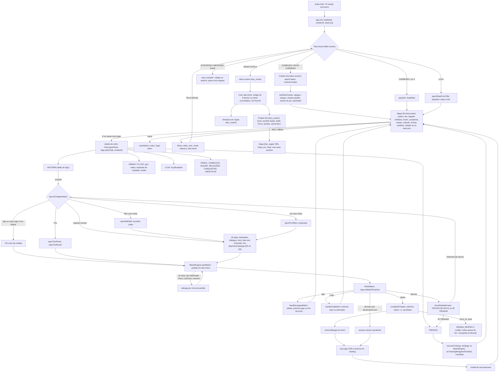

# Fase 0: arquitetura, estado e save, desempenho e estabilidade

Auditoria só de leitura, feita em 12/11/2026 sobre `main` (e4ba51c). Nenhum arquivo do projeto foi alterado.

**Como foi medido.** Máquina: i7-4770, Intel HD 4600, 16 GB e Windows 11. O Chrome rodou sem janela com a GPU de verdade (`run_game_hw.ps1`). O "celular emulado" usa tela de 844×390, dpr 2, toque e CPU 4× mais lenta. Durante as medições havia mais **3 Chromes de outros agentes** abertos, então os números são pessimistas e variam de uma rodada para outra: o carregamento no PC deu 2,6 s numa rodada e 6,7 s noutra. As funções mais pesadas saíram de perfis de CPU (CDP Profiler, amostra a cada 0,5 ms).

Scripts e resultados brutos ficam em `audit0\`: `arq_boot.js`, `arq_boot_mob.js`, `arq_save.js`, `arq_boot_poison.js`, `arq_cine.js`, `arq_cine_bug.js`, `arq_abas.js`, `prof_hub.js` e `prof_load.js`. A pasta também tem `run_prof.ps1` (cópia do runner com profiler) e `prof_agg.ps1`, além dos `*.txt` e `*.cpuprofile`. O print está em `BlueLockCareer\audit_screens\tecnico\cine_nagi_reo_travada.png`.

---

## 1. Mapa do projeto

### 1.1 Totais

- O `index.html` (35,9 KB) carrega **76 `<script>` síncronos** no fim do `<body>`: 5 991 KB e 124 355 linhas, ou cerca de 1,68 MB com gzip. Carrega também **11 CSS** (443 KB). São uns **6,4 MB de texto** baixados e interpretados a cada abertura. Não há build, `defer` nem carregamento sob demanda.
- Ícones: 620 KB. A pasta `musica/` só tem o `LEIA-ME.txt`.
- No repositório git há 103 arquivos versionados.

**Pastas fora do jogo (só citar):**

| Pasta | Tamanho |
|---|---|
| `_backup_antes_atributos_novos` | 276 KB |
| `_backup_antes_selecoes` | 1,0 MB |
| `_backup_antes_todas_as_telas` | 2,3 MB |
| `_backup_antes_wildcard` | 676 KB |

Os quatro backups somam cerca de 4,2 MB e estão no `.gitignore`. Além disso, `previa_sprites/` tem 240 MB na raiz (não versionada) e `.claude/` tem 23 MB.

### 1.2 Ordem de carregamento (`index.html:616-691`)

```
data_characters → data_weapons_flows → data_story → data_duo
→ sound_engine → music_engine → pixel_renderer → sprite_rig → data_animations → sprite_bridge
→ cutscene_engine → cine_kit → 22× cine_* (2D)
→ bg_estadios → bg_bluelock → bg_mundo
→ match_engine → ego_fx → vendor/peerjs.min → duo_net → duo_match
→ app → save_transfer → duo_mode → duo_career → duo_saga
→ ui_shell → easter_eggs → mobile → ui_historia → ui_perfil → ui_colecao → ui_time
→ hub → hub3d → hub3d_cidade → hub3d_gl
→ cine3d → cine3d_kit → 15× cine3d_* (com cine_art.js no meio)
```

`App.init` roda no `DOMContentLoaded` (`app.js:4777`), e `Hub.init` também (`hub.js:2185`).

**A ordem das tags é parte da lógica.** Os arquivos de baixo "embrulham" funções dos de cima (monkey patch):

- `App.renderTitleMenu` é embrulhado **4 vezes**, como aparece na pilha de um erro reproduzido: `mobile.js:54` → `ui_shell.js:175` → `duo_mode.js:510` → `save_transfer.js:202` → `app.js:228`.
- `App.switchTab` é embrulhado por `hub.js:1712` e por `mobile.js`.
- `CE.play` e `CE.playActionSakuga` são embrulhados por `cine3d.js` e por `cine3d_kit.js:354`/`:530`.
- Os `ui_*.js` substituem por inteiro `App.renderStoryHub`, `renderTrainingTab` e outras.

Trocar duas tags de lugar quebra o jogo sem erro claro.

### 1.3 Arquivos por subsistema

Os tamanhos estão em KB; L é o número de linhas.

**Estado e carreira**

| Arquivo | KB | L | Responsabilidade |
|---|---:|---:|---|
| js/app.js | 223,4 | 4780 | Objeto `App` inteiro: estado (`defaultState`), save e migrações, tela inicial, criador, as 11 abas (`render*`), giros e loja, ligas NEL e pro, Copa, Trio, fluxo dos capítulos, treinos, conquistas |
| js/save_transfer.js | 9,4 | 213 | Exportar e importar save (`BLSAVE1:`+base64, ou arquivo) e `cleanForeignSave` |
| js/easter_eggs.js | 13,2 | 291 | Segredos (+100 EgoCoins), gravados em `state.easterEggs` |

**Dados e textos**

| Arquivo | KB | L | Responsabilidade |
|---|---:|---:|---|
| js/data_story.js | 206,6 | 3386 | 21 capítulos (`CAREER_CHAPTERS`), diálogos, interlúdios, ranking; 636 falas `speaker:` |
| js/data_characters.js | 40,0 | 572 | 66 personagens e acessórios |
| js/data_weapons_flows.js | 51,8 | 975 | Armas, skills e Fluxos (7 raridades) |
| js/data_duo.js | 46,0 | 757 | Capítulos e falas do Projeto Elo (dupla) |
| js/data_animations.js | 20,7 | 336 | Quadros-chave dos bonecos (Sprites 2.0) |

**Bonecos e render 2D**

| Arquivo | KB | L | Responsabilidade |
|---|---:|---:|---|
| js/pixel_renderer.js | 113,9 | 1810 | `PixelRenderer`: desenho dos bonecos (motor antigo) e utilidades de cor |
| js/sprite_rig.js | 99,2 | 2284 | Sprites 2.0: esqueleto e cache de quadros (até ~22 MB de canvas) |
| js/sprite_bridge.js | 17,3 | 360 | Liga o `PixelRenderer` ao `sprite_rig` (`?sprites=old` volta ao antigo) |

**Partida**

| Arquivo | KB | L | Responsabilidade |
|---|---:|---:|---|
| js/match_engine.js | 270,8 | 6127 | `MatchEngine`: partida semi-3D, IA, controles, minijogo de treino, relatório e nota |
| js/ego_fx.js | 21,8 | 430 | Efeitos de anime na partida (emblema do ego, faixa dos olhos) |
| js/mobile.js | 23,2 | 558 | Controles de toque, escala de HUD e tela, registro do service worker; embrulha `ME` e `App` |
| js/match_gfx.js | 9,8 | 247 | **Morto**: gramado com textura, tirado do index no commit e1639ae ("ele não gostou") |

**Mapa 3D (hub)**

| Arquivo | KB | L | Responsabilidade |
|---|---:|---:|---|
| js/hub.js | 95,1 | 2187 | Base do `Hub`: tema por capítulo, HUD, menu, painéis de vidro, laço do mapa e o mapa 2.5D antigo (modo reserva) |
| js/hub3d.js | 136,9 | 3187 | Prédio em 3D: `World` (planta, luz, `prepare`, cache de 2 temas), áreas, ações, raycasting (reserva sem WebGL2) |
| js/hub3d_gl.js | 70,3 | 1639 | WebGL2: prédio, sprites, reflexo, bloom, qualidade automática (6 níveis), perda de contexto |
| js/hub3d_cidade.js | 80,8 | 1786 | Cidade (tema pro): rua, praça, pedestres, fãs |

**Diálogos (VN) e fundos**

| Arquivo | KB | L | Responsabilidade |
|---|---:|---:|---|
| js/cutscene_engine.js | 308,8 | 6961 | `CutsceneEngine`: diálogo VN (`play`/`next`/`choose`), motor de sakuga, cerca de 25 cenas antigas desenhadas aqui, fundos do VN |
| js/bg_estadios.js | 103,7 | 2535 | Fundos pintados por código (estádios e salas) |
| js/bg_bluelock.js | 80,3 | 1877 | Fundos do Blue Lock |
| js/bg_mundo.js | 126,4 | 2728 | Fundos do mundo (Espanha, Paris, hotel...) |
| js/cine3d.js | 27,6 | 621 | Diálogo filmado em 3D, dentro do prédio |

**Cutscenes 2D antigas (`cine_*`)**

- `cine_kit.js` (22,5 KB, 550 linhas) faz o `registerCine`, a moldura (tarjas, legendas, granulado) e os helpers `cine*`, que **as cenas 3D também usam**.
- `cine_art.js` (26,9 KB, 704 linhas) desenha a arte vetorial dos closes (olhos, silhuetas, painéis de mangá) e também é usado pelas 3D.

| Grupo | Arquivos (KB) | Situação |
|---|---|---|
| 2D **com** versão 3D (63 cenas) | cine_inicio 84,1 · cine_selecao1 101,3 · cine_selecao2 125,5 · cine_manga 125,1 · cine_partida 117,7 · cine_luck 86,2 · cine_rin 73,7 · cine_hugo 19,8 · cine_wildcard 124,3 · cine_federacao 117,2 · cine_fox 137,4 · cine_fox2 85,0 · cine_espanha 100,8 · cine_final 139,9 · cine_final_franca 75,2 · cine_bola_ouro 89,8 · cine_duo 77,0 | Cerca de **1,56 MB** que só tocam sem WebGL2 ou se o 3D falhar (`cine3d_kit.js:338-386`). Mas guardam helpers usados pelas 3D (`fin*`, `foxc*`, `bdor*`, `esp*`, `fedx*`, `duo*`, `fx2*`, `mgm*`), então **não dá para apagar** sem antes extrair esses helpers |
| 2D **sem** versão 3D (em uso) | cine_fluxos_a 136,6 · _b 148,0 · _c 56,4 · _d 62,0 · _e 15,4, mais `flow_awaken` (em cine_partida) | As 23 cenas de Fluxo `flow_fl_*` e o `flow_awaken` |

**Cutscenes 3D (`cine3d_*`)**

| Arquivo | KB | Cenas |
|---|---:|---|
| cine3d_kit.js | 26,3 | `registerCine3D`, troca 2D/3D, adiantamento do prédio e dos bonecos, `cineFreeze` |
| cine3d_inicio | 72,0 | bluelock_door, ego_speech, onigokko, prologue_tada_miss |
| cine3d_selecao1 | 84,4 | barou_king(_win), chigiri_sprint, ego_victory, kuon_betrayal |
| cine3d_selecao2 | 86,9 | barou_devour, bluelock_man_test, rin_takes_bachira(_win), world_five_fall/win |
| cine3d_manga | 43,4 | itoshi_snow, nagi_reo_split |
| cine3d_partida | 91,8 | chem_reaction, first_selection_awakening, nel_metavision_goal, scripted_shot, u20_final_goal |
| cine3d_u20 | 36,0 | u20_direct_shoot |
| cine3d_rin | 47,3 | hugo_gears, rin_rival, sae_interview |
| cine3d_wildcard | 88,0 | 4 cenas do Wild Card |
| cine3d_federacao | 68,4 | bl_eleven, ego_federation, shidou_cut |
| cine3d_fox / fox2 | 106,3 / 41,0 | credits, fox_training, monster_awaken, rin_challenge, u20_celebration, wc_champion, wc_opening / four_egos_intro, fox_entrance, fox_watch |
| cine3d_espanha | 104,5 | captain_speech, clasico_bunny, ego_ticket, loki_hugo_promise, spain_flight |
| cine3d_final | 175,4 | ballon_dor, camp_night, convocation_call, epilogue_destinies, rin_final_duel/end, wc_final_goal |
| cine3d_bola_ouro | 56,0 | bola_de_ouro_discurso, rin_sae_licao |
| cine3d_duo | 95,6 | 6 cenas `duo_*` |

**Áudio**

| Arquivo | KB | L | Responsabilidade |
|---|---:|---:|---|
| js/sound_engine.js | 8,5 | 264 | Efeitos sintetizados (Web Audio) e mudo |
| js/music_engine.js | 30,0 | 747 | Trilhas sintetizadas e `musica/<tema>.mp3` opcional |

**UI e abas**

| Arquivo | KB | L | Responsabilidade |
|---|---:|---:|---|
| js/ui_shell.js | 7,5 | 181 | Enfeites da barra, do cabeçalho e da tela inicial (embrulha o `App`) |
| js/ui_historia.js | 27,0 | 551 | Aba HISTÓRIA (substitui `renderStoryHub`) |
| js/ui_perfil.js | 46,6 | 937 | PERFIL, EQUIPE, RELAÇÕES e o criador |
| js/ui_colecao.js | 54,3 | 1054 | ARMAS, FLUXO, LOJA e roleta |
| js/ui_time.js | 40,4 | 855 | TREINOS, CONQUISTAS e OBJETIVOS |

**Modo dupla online**

| Arquivo | KB | L | Responsabilidade |
|---|---:|---:|---|
| js/vendor/peerjs.min.js | 90,7 | 8 | PeerJS 1.5.4 (WebRTC). **Carregado sempre** |
| js/duo_net.js | 6,8 | 209 | Sala com código, conexão, ping |
| js/duo_match.js | 39,2 | 990 | Partida em duas telas (o host simula, o convidado desenha) e Worker de relógio |
| js/duo_mode.js | 21,6 | 523 | Tela da sala (criar/entrar, amistoso) |
| js/duo_career.js | 32,8 | 784 | Projeto Elo: save da dupla, passos sincronizados |
| js/duo_saga.js | 27,3 | 591 | Saga da dupla (NEL, Copa, pro...) num "save sombra" |

**Raiz e PWA**

| Arquivo | KB | L | Responsabilidade |
|---|---:|---:|---|
| index.html | 35,9 | 694 | Toda a marcação (tela inicial, criador, 11 abas, VN, sakuga, partida, modais) e os 76 scripts |
| sw.js | 1,5 | 37 | Service worker "rede primeiro" (cache `blue-lock-v1`); só registra em http(s) (`mobile.js:18`) |
| manifest.webmanifest | 0,6 | 18 | PWA em tela cheia |

**CSS (443 KB no total)**

| Arquivo | KB | Responsabilidade |
|---|---:|---|
| style.css | 64,2 | Base e telas antigas |
| atributos.css | 25,0 | Aba ATRIBUTOS |
| ui_shell.css | 38,9 | Barra e tela inicial |
| ui_historia.css | 34,1 | HISTÓRIA |
| ui_perfil.css | 71,8 | PERFIL, EQUIPE, RELAÇÕES, criador |
| ui_colecao.css | 72,9 | ARMAS, FLUXO, LOJA |
| ui_time.css | 48,6 | TREINOS, CONQUISTAS, OBJETIVOS |
| mobile_telas.css | 28,3 | Telas no celular |
| mobile.css | 15,5 | HUD de toque |
| duo.css | 18,0 | Modo dupla |
| hub.css | 25,3 | Mapa e janelas de vidro |

### 1.4 O que parece morto ou duplicado

1. **`js/match_gfx.js`** não é carregado. Só sobra a checagem `this.drawPitchTextured &&` em `match_engine.js:5458`.
2. **Funções sem chamada:** `App.resetCareer` (`app.js:965`), `unlockBlueLockNowForTest` (`app.js:1976`) e `previewAnimeSakuga` (`app.js:3944`).
3. **Cenas que nunca tocam:**
   - `u20_final_goal` tem versão 2D (`cine_luck.js:1766`) e 3D (`cine3d_partida.js`), mas nenhum dado ou código a dispara.
   - `four_egos_world_cup` está em `LEGACY_SAKUGA` (`cutscene_engine.js:280`) sem gatilho.
4. **2D × 3D.** Das 87 cenas 2D, 63 têm versão 3D. As **legendas estão copiadas** nas duas versões: 35 de 36 falas de `cine_selecao1` são idênticas em `cine3d_selecao1`, e 25 de 25 em `cine_federacao`/`cine3d_federacao`. Uma correção de lore precisa ser feita em dois lugares.
5. **Três desenhadores para o mesmo mapa:** `hub.js` (2.5D), `hub3d.js` (raycasting) e `hub3d_gl.js` (WebGL2). Os dois primeiros são reserva.
6. **Dois motores de bonecos:** `pixel_renderer` (antigo) e `sprite_rig` (atual), ligados pelo `sprite_bridge`.
7. **Helpers repetidos:** `clamp`, `seg`, `ease` e `lerp` são definidos de novo em 36 a 38 arquivos; `esc` em 7.
8. **Textos espalhados:**
   - Diálogos ficam em `data_story.js` (636 falas), mas também em `app.js` (22), `easter_eggs.js` (16), `duo_saga.js` (10) e `cine3d.js`.
   - Legendas das cenas ficam dentro de cada `cine*`.
   - 36 `notify()` com texto direto em `app.js`.
   - Os HTMLs das abas estão em template strings nos `ui_*.js`.

---

## 2. Fluxo de telas



No **modo clássico**, o menu do mapa troca a janela de vidro por abas no topo (`hub.js:1665`). O prólogo é o capítulo `ch0_prologue`: tem um dilema (`triggerProloguePassCutscene`, `app.js:3959`) e sempre conta como vitória (`match_engine.js:6118`).

---

## 3. Estado e save

### Onde vive o estado

**`App.state`** (formato em `app.js:14-112`) é o estado central na prática, mas **sem camada de acesso**:

- É lido e alterado direto em 16 arquivos. Referências: `app.js` 322, `ui_perfil` 25, `ui_time` 14, `ui_historia` 8, `ui_colecao` 8, `duo_saga` 7, além de `hub*`, `easter_eggs` e `match_engine`.
- Não há setters nem eventos. A "reatividade" é chamar `renderAll()`, que remonta as 11 abas.
- `duo_saga.withShadow` (`duo_saga.js:113-129`) **troca o `App.state` por outro objeto** e desliga `saveState`, `renderAll` e `notify` enquanto faz uma conta.

**Estado que não vai para o save:**

- `Hub`: sala, posição, painel aberto. Ao reabrir, você volta para o quarto.
- `MatchEngine`: a partida em andamento. Fechar a aba no meio perde só a partida.
- `CutsceneEngine`: o diálogo atual.
- `Duo` e `DuoCareer.career`: memória do modo dupla.

### Chaves de armazenamento

Tudo é `localStorage`. Não há IndexedDB nem sessionStorage. O service worker usa Cache Storage `blue-lock-v1` só para os arquivos do jogo.

| Chave | Conteúdo |
|---|---|
| `bluelock_egoist_career_v2` | Carreira 1 (JSON do `App.state`). Novo: 1,6 KB. Fim de jogo montado (todos os capítulos, NEL e pro simuladas, tudo liberado): **10,8 KB** |
| `bluelock_egoist_career_v2_slot2` | Carreira 2 |
| `bluelock_active_slot` | Espaço aberto por último |
| `bluelock_rewind_nel_v1` e `bluelock_backup_slot1_antes_da_nel` | Marca e cópia **únicas** da migração "volta para a NEL" de 29/10 (`app.js:166-195`) |
| `bluelock_duo_careers` | **Todas** as carreiras em dupla (`elo-xxxx`), cada uma podendo levar um save solo inteiro (`save.solo`). Nunca é podada |
| `bluelock_duo_pid` | Id do aparelho |
| `bluelock_muted`, `bluelock_hub_off`, `bluelock_hub_gfx`, `bl_sprites`, `bl_hud_tamanho`, `bl_tela_tamanho` | Preferências |

**Limite de 5 MB:** não é risco hoje. O save do fim do jogo ocupa cerca de 0,2% do limite. O maior pedaço é `nel` com 2,7 KB.

### Versão e migrações

- **Não existe `saveVersion`.** O único número de versão é `storyVersion` (1 → 2 → 3), usado só por `migrateChapterIndex` (v<2) e `migrateProtagonistLook` (v<3). As duas gravam no `localStorage` de dentro do `loadState` (`app.js:920`, `:938`).
- As outras "migrações" são **heurísticas sem versão**, repetidas em todo carregamento (`app.js:734-783`): tutorial, inserção do `ch12b_wc_camp`, `migrateCupGroups` (usa `cup.v`), `skipCompletedChapters`/`extraForOldSaves`, ajuste de rodada do Trio e da Copa, `chapterResults` do cap. 1, `migrateProClubs`, `markPostMatchScenesSeen`, `enforceRivalries`, `monsterUnlocked`, `resolveFlow` e o pé AMBOS. Fora do `loadState` há ainda `rewindSlotToNel`, que roda uma vez por navegador.
- **Normalização** só para `currencies`, `stats`, `profile` e `career`, com números finitos (`app.js:720-733`). Arrays e objetos (`completedChapters`, `unlockedAchievements`, `equippedAccessories`, `affinities`, `nel`, `pro`, `cup`...) **não são validados**.

### Save corrompido (reproduzido)

`loadState` pega qualquer exceção e troca o estado pelo **padrão em silêncio** (`app.js:787-789`). Ele marca `hasSave = true` antes do parse (`:715`). Não há backup automático nem opção de recuperar.

| Situação | O que acontece |
|---|---|
| JSON inválido | A carreira some do menu. Começar de novo apaga o save |
| Migração lança erro | O menu mostra a carreira, mas ela carrega zerada. O primeiro save grava por cima |
| Tipo errado em array ou objeto | A abertura trava |

Detalhes e passos na seção 5.

### Autosave

O save é feito por evento: `saveState()` em 39 pontos de `app.js`, mais `match_engine.js:635`, `easter_eggs.js:47` e a cama do mapa (`hub3d.js:2776`). Isso cobre fim de partida e de capítulo, compra, giro, treino, upgrade, escolha de diálogo e início de capítulo. Não há save em `pagehide`/`visibilitychange`, mas também não faz falta. **A partida em andamento não é salva.**

### Proteção do storage

Todo acesso tem `try/catch`, exceto `resetCareer` (`app.js:967`, código morto). Porém o erro é **engolido sem aviso** (`app.js:956-961`), e a cama mostra "💾 Jogo salvo" mesmo quando nada foi gravado.

### Exportar e importar (`save_transfer.js`)

- O código é `BLSAVE1:` + base64 do JSON.
- `decode` só confere se existem `profile` e `currencies` (`:48-49`).
- `cleanForeignSave` tira `<>`, troca aspas e `&`, corta textos e zera números não finitos. Isso protege bem contra XSS, **mas não valida tipos**.
- Importar sobrescreve o espaço no segundo clique, **sem backup do save antigo** e sem checar a versão do jogo.

### Modo dupla

- O host é a autoridade. O save escolhido é o de maior `rev` (`duo_career.js:68-71`), e o recebido passa por `cleanForeignSave` (`:162`).
- Tudo fica numa única chave que só cresce.
- A saga usa um "save sombra" que fica no lugar do `App.state` durante as contas.

### Riscos concretos (por ordem)

1. **Qualquer bug futuro numa migração apaga carreiras.** A exceção vira estado padrão, que é gravado por cima.
2. Um save importado ou estranho **trava a abertura** (sem menu ou sem loop) e só sai limpando os dados do site.
3. Não há **backup do último save válido** nem tela de recuperação.
4. Falha ao gravar é silenciosa (cota cheia ou aba anônima).
5. **Duas abas abertas:** a última a gravar ganha e apaga o progresso da outra (não há evento `storage`).
6. Importar não guarda o save antigo.
7. A migração ad hoc `rewindSlotToNel` vale para um único save e continua no código.

---

## 4. Desempenho (medido)

### Até o jogo ficar pronto

| Momento | PC (GPU) | Celular emulado |
|---|---|---|
| Primeira pintura (HTML parado, sem menu) | 2,7 s | 6,6 s |
| Scripts interpretados (`domInteractive`) | 2,6 s a 6,7 s | 14,8 s |
| `App.init` e `Hub.init` prontos: tela inicial clicável (`DOMContentLoaded` end) | 3,5 s a 7,3 s | **18,2 s** |
| `load` | 3,7 s a 7,3 s | 19,9 s |
| Nova carreira até o mapa (pulando os diálogos) | 4,2 s | 28 s |

**O que mais pesa no carregamento** (perfil de CPU, PC):

- **`peerjs.min.js`: 1,86 s, 41%.** O PeerJS testa o WebRTC (`new RTCPeerConnection` e `createDataChannel`) assim que o arquivo carrega, mesmo sem ninguém usar o modo dupla.
- `bg_estadios.js`: 0,63 s, 14% (fundos do VN pintados no boot).
- `sprite_rig`: 0,30 s.
- `App.init`: 0,20 s.

O resto é parse dos 6 MB.

### Mapa 3D

| Medida | PC | Celular emulado |
|---|---|---|
| Quadro parado (mediana / p95 / máx) | 20–40 / 40–80 / 120–150 ms (**25 a 50 fps**) | 30–60 / 220–660 / 630–1080 ms (**7 fps**) |
| Andando | 30 / 90 ms | 90 / 440 ms |
| `Hub.draw` (mediana) | 25 ms | 29–57 ms |
| Nível de qualidade automática | **5 de 5 (o mínimo, resolução 42%)** | 5 |

**Por que pesa** (perfil): no PC, **69% da CPU do mapa** vai para `getImageData` dentro de `charTex` (`hub3d.js:2555-2571`), chamado em `hub3d_gl.js:1349`. A cada troca de quadro da animação de cada boneco, o jogo:

1. redesenha o sprite (`sprite_rig.buildFrame`);
2. lê os pixels de volta (`getImageData`);
3. envia uma textura nova para a placa.

No celular emulado o peso aparece como `getImageData` (24%), coletor de lixo (12%) e `uniform2f` (8%), que é a espera da placa depois desses envios. Tem ainda `Hub.canAct` com `querySelector` em todo quadro (4% a 8%, `hub.js:1591`).

**Consequência:** a qualidade automática (`hub3d_gl.js:1493-1506`) derruba a resolução até o mínimo para compensar um gargalo que é de CPU, não de placa. O mapa fica feio e continua lento.

### Troca de tema (avanço de fase): `World.prepare` síncrono

O `World.prepare` (`hub3d.js:1364-1398`) congela a tela durante a troca:

| Tema | PC | Celular emulado |
|---|---:|---:|
| Blue Lock | 629 ms | 3,8 s |
| Sub-20 | 348 ms | – |
| NEL | 378 ms | 3,4 s |
| Copa Sub-20 | 542 ms | – |
| Pro com cidade | **858 ms** | **10,7 s** (3,7 s noutra rodada) |
| Japão com cidade | 696 ms | – |
| Volta para um tema que já saiu do cache de 2 | 564 ms | 1,1 s |

No perfil, o peso está em `bakeGen` (`hub3d.js:1644`, 18%), `getImageData` (14%), `buildLightGen` (6%) e `fillGen` (5%). Já existe uma montagem em fatias (`fillGen`/`prewarmGen`), mas o `prepare` normal ainda **termina tudo de uma vez**.

### Partida (`ch9_world_cup_final`, 10 jogadores, 12 s andando)

| Medida | PC | Celular emulado |
|---|---|---|
| Intervalo entre quadros | média 10 ms, p95 10 ms, máx 70 ms; 2 quadros acima de 50 ms (**estável**) | média 50 ms (**20 fps**), p95 220 ms, máx 1,18 s; 53 quadros acima de 50 ms |
| `draw()` | 1,35 ms (p95 4,3) | 31 ms (p95 166) |
| `update()` | 0,22 ms | 1,3 ms |
| Montagem de sprites com cache frio | 649 quadros, 2,2 s | 259 quadros, **5,2 s** |

O que pesa é montar os quadros dos bonecos no começo da partida (`sprite_rig.buildFrame`).

### Cutscenes 3D (quadro inteiro: render 3D, overlay e moldura)

| Cena | PC: média / p95 | PC: 1º quadro real | Celular emulado |
|---|---|---|---|
| ego_speech | 67 / 62 ms (15 fps) | 4,9 s | 1º quadro **14,5 s** (pior caso: cenário de outra fase sem adiantar, como no REVER) |
| u20_final_goal | 44 / 73 ms (22 fps) | 0,24 s | 60 / 218 ms (16 fps) |
| ballon_dor | 100 / 111 ms (**10 fps**) | 5,8 s (1 095 canvas criados) | – |
| wildcard_door | 39 / 59 ms (25 fps) | 0,66 s | – |
| Fluxo 2D (flow_fl_lendario_rei) | 15 / 34 ms | 0,7 s | – |

O primeiro quadro é caro porque monta o prédio do tema da cena e os bonecos (76 a 158 montagens, 1,7 a 6,1 s). O sistema de adiantamento (`cine3d_kit.js:395-566`) ajuda quando a cena é do capítulo atual, mas não cobre o REVER nem cenas fora do roteiro previsto.

### Abas (`switchTab` chama `renderAll`, que remonta as 11 abas)

| Aba | PC | Celular emulado |
|---|---:|---:|
| ARMAS | 281 ms | **641 ms a 3,0 s** |
| RELAÇÕES | 374 ms | 1,4 a 2,0 s |
| EQUIPE | 197 ms | 850 ms |
| FLUXO | 150 ms | 0,4 a 1,3 s |

A causa principal é `renderWeaponsTab`: **874 ms por `renderAll`** no celular emulado, porque refaz os 2 197 nós da aba ARMAS por `innerHTML`, esteja ela visível ou não. A aba RELAÇÕES tem 1 488 nós. O DOM total tem cerca de 7 000 elementos e 129 canvas.

### Memória

- Heap JS: 12 MB no boot, **120 MB** depois de visitar os 9 temas no PC, cerca de 100 MB durante cenas e 73 MB depois do coletor de lixo.
- Canvas que continuam presos depois de tocar as 63 cenas 3D: **68 MB** (eram 91 MB em 10/11). Os maiores: cache do `sprite_rig` (22 MB), `cine3d_rin` (6,3 MB), `cine_art.silMask` (5,8 MB), `cine3d_manga` (3,5 MB) e `charTex` do mapa (3,1 MB).
- `releaseCineCaches` só limpa as chaves `_` do `CE`. Os caches de módulo das cenas 3D ficam.
- As texturas do WebGL não foram medidas.

### Resumo: o que mais pesa

1. `charTex` com `getImageData` por quadro no mapa (`hub3d.js:2555`).
2. `World.prepare` síncrono na troca de tema (`hub3d.js:1364`, `bakeGen` em `:1644`).
3. Primeiro quadro das cenas 3D (prédio e bonecos).
4. `renderAll` remontando todas as abas, principalmente `renderWeaponsTab`.
5. 6 MB de JS síncronos, mais o PeerJS testando WebRTC no boot.
6. Sprites com cache frio no começo da partida (pesa no celular).

---

## 5. Estabilidade e bugs

### Console

Em **toda abertura** aparecem 8 erros `Failed to load resource: musica/{u20,epic,victory,tension,travel,mystery,dread,promise}.mp3`. Vêm de `music_engine.js:311-325`, que procura os mp3 opcionais.

Fora isso, ficaram **limpos**: mapa, nove temas, partida, 4 cenas 3D e 1 cena de Fluxo. Não apareceram avisos (warnings).

Os erros que surgiram vieram de dois lugares: a cena que trava (bug 1) e saves estranhos (bugs 2 a 5).

### Lista de bugs

| # | Título | Passo a passo | Gravidade | Onde | Situação |
|---|---|---|---|---|---|
| 1 | **Cutscene congela na 2ª vez que a coroa aparece** | 1) No arco da 2ª Seleção, ver `barou_devour` até o fim. 2) Tocar `nagi_reo_split`: no plano 3 (t≈150) a imagem para, com um retângulo preto e sem legendas. Para seguir, só clicando AVANÇAR ou PULAR. Rever `barou_devour` (REVER) trava do mesmo jeito | **Alto** | O fim da cena chama `releaseCineCaches` (`cutscene_engine.js:400-424`), que **esvazia** o objeto `CE._mgmCrownP` mas o deixa no lugar. `mgmCrownPieces` (`cine_manga.js:279-280`) só confere `if (this._mgmCrownP)` e recebe `{}`. Daí `mgmPartAt` lê `e.ppu` de undefined (`cine_manga.js:155`), chamado de `cine3d_manga.js:160` e `cine3d_selecao2.js:1189`. O laço da cena (`cutscene_engine.js:337-349`) e o `drawCine` (`cine_kit.js:72-109`) não têm try/catch: o rAF morre, o relógio para e sobra um `ctx.save()` sem `restore` | **Reproduzido** (`arq_cine_bug.js`; relógio parado em t=152; print `audit_screens/tecnico/cine_nagi_reo_travada.png`) |
| 2 | **Exceção no carregamento zera a carreira e o save é gravado por cima** | Um save com um campo de tipo errado que faça uma migração lançar (ex.: `completedChapters: null`). Abrir o jogo: o menu mostra "CARREIRA 1 • Cap. 5". Clicar: entra com OVR 0, 0 moedas, cap. 0. A primeira ação que salva destrói o save real | **Crítico** (perda de save; hoje qualquer bug de migração faz isso) | `app.js:703-790` (catch em `:787`); o menu usa outra normalização em `slotSummary` (`app.js:207-222`) | **Reproduzido** com save injetado (`arq_save.js`, `arq_boot_poison.js`) |
| 3 | **Save com JSON inválido some sem aviso** | Save com o texto cortado. Abrir: o menu mostra só COMEÇAR CARREIRA e IMPORTAR. Começar apaga o save antigo, sem backup e sem oferecer recuperação | **Alto** | `app.js:715` (`hasSave` antes do parse), `:787`, `:306` | **Reproduzido** |
| 4 | **Save com campo `null` trava a abertura** | Importar ou ter um save com `unlockedAchievements: null` (ou `equippedAccessories: null`, ou `nel: {}` estando na NEL). Ao abrir, `App.init` para no `renderAll` e o loop principal (`startLoop`) nunca roda. Clicar na carreira não faz nada, porque `playSlot` lança antes de `closeTitleScreen` | **Alto** | `app.js:120` → `checkAchievements` `:4274`; `playSlot` `:285-295`; `decode` só confere profile e currencies (`save_transfer.js:48-49`) | **Reproduzido** (`loopDoJogo:false`) |
| 5 | **Menu inicial vazio (sem nenhum botão)** | Save com `completedChapters` sendo objeto em vez de lista. Ao abrir, a tela inicial aparece sem nenhum botão, nem IMPORTAR | **Alto** (soft-lock) | `slotSummary` → `skipCompletedChapters`, `app.js:839` | **Reproduzido** |
| 6 | **Falha ao salvar é silenciosa e a cama mente** | Navegador sem espaço ou em modo restrito. Descansar na cama mostra "💾 Jogo salvo" mesmo sem ter gravado | Médio | `app.js:956-961`; `hub3d.js:2776-2778` | Suspeita pela leitura (o teste de cota não falhou porque o save tem só 11 KB) |
| 7 | **Duas abas apagam o progresso uma da outra** | Abrir o jogo em 2 abas, jogar na A, depois fazer qualquer coisa que salve na B. O progresso da A se perde | Médio | Não há listener `storage` em lugar nenhum | Suspeita pela leitura |
| 8 | **Importar substitui sem backup e sem versão** | Importar por cima de uma carreira (2º clique) apaga a antiga para sempre. Um save de outra versão entra sem migração dirigida | Médio | `save_transfer.js:173-181` | Leitura |
| 9 | **Interlúdio marcado como visto antes de tocar** | Começar um capítulo com interlúdio novo e fechar a aba no meio. Ele não toca de novo (só pelo REVER) | Médio | `app.js:3680-3690` | Leitura |
| 10 | **Trava longa ao avançar de fase** | Concluir o último capítulo de uma fase, ex.: entrar na liga pro. A tela congela 0,4 a 0,9 s no PC e **3 a 10,7 s** no celular emulado. REVER uma cena de outra fase: 1º quadro de 5 a 14 s | Médio | `hub3d.js:1364-1398`; `cine3d_kit.js:365-372` | **Medido** |
| 11 | **Console sujo em toda abertura** | Abrir o jogo sem mp3 na pasta `musica/`: 8 erros "Failed to load resource" | Baixo | `music_engine.js:311-325` | **Reproduzido** |
| 12 | **Callback de fim de cena sem proteção** | Se o `onComplete` de um diálogo ou cena lançar, o capítulo para no meio (sem partida ou sem prêmio) e não aparece aviso. `App.init` também não tem proteção | Baixo/Médio | `cutscene_engine.js:232-236`, `:438-442`; `app.js:114-124` | Leitura |
| 13 | **Diálogo vazio pede um clique à toa** | `CE.play` com lista de falas vazia abre a caixa sem texto, esperando clique | Baixo | `cutscene_engine.js:38`, `:6832-6833` | Leitura |
| 14 | **Atributo em texto vira 0** | Save com `"velocidade":"50"`: o valor vira 0 em vez de 50 | Baixo | `app.js:728-733` | **Reproduzido** |
| 15 | **Capítulo inválido mostra "Campeão do Mundo"** | Save com `currentChapterIndex` igual a `'abc'` ou 999 | Baixo | `app.js:2885`, `:214` | **Reproduzido** |
| 16 | **Memória de cenas presa** | Tocar muitas cenas 3D na mesma sessão: chegam a 68 MB de canvas presos nos caches de módulo (no celular aumenta o risco de a aba ser derrubada) | Baixo/Médio | caches em `sprite_rig.js` e `cine3d_*` (fora do `releaseCineCaches`) | **Medido** |
| 17 | **Conteúdo órfão** | `u20_final_goal` (2D e 3D) e `four_egos_world_cup` nunca são disparadas | Baixo | `cine_luck.js:1766`, `cine3d_partida.js`, `cutscene_engine.js:280` | Leitura e varredura dos dados |

**O que não apresentou problema:**

- Partida termina uma vez só: há trava contra chamada dupla (`match_engine.js:6090-6101`).
- Listeners têm guarda contra duplicação.
- Perda de contexto do WebGL é tratada (`hub3d_gl.js:368`).
- `setInterval` contínuos são poucos: `cine3d_kit.js:560` (2,5 s), `hub3d.js:3173` e `:3176`. Não acumulam.
- Atributos e moedas `NaN` são limpos no carregamento.
- O save não chega perto do limite de 5 MB.

---

## 6. Notas

| Área | Nota | Justificativa |
|---|:-:|---|
| **Performance** | **4/10** | No PC a partida é leve (draw de 1,4 ms, estável). O mapa 3D só chega a 25–50 fps com a resolução no mínimo, por causa de um gargalo de CPU (`charTex`). As cenas 3D rodam a 10–25 fps, com 1º quadro de até 5,8 s. A troca de fase congela 0,4 a 0,9 s. No celular emulado a abertura leva 18 s, o mapa roda a 7 fps, a partida a 20 fps com picos de 1 s, a troca de fase congela até 10,7 s e abrir a aba ARMAS leva até 3 s. Os gargalos são poucos e bem localizados, então dá para ganhar muito com pouco. |
| **Estabilidade e save** | **4/10** | Console quase limpo. Partidas, mapa e 63 cenas rodaram sem exceção, com uma exceção: há uma cutscene que trava, reproduzida. O save é pequeno e o storage tem `try/catch`. Mas o save não tem versão de verdade nem validação; um erro no carregamento zera a carreira e grava por cima; não há backup nem recuperação; saves com tipo errado travam a abertura; falhas de gravação são silenciosas; duas abas se sobrescrevem. |

---

## 7. Backlog da minha parte

Ordenado por impacto alto e esforço baixo primeiro. Impacto e esforço vão de 1 a 5.

| # | Tarefa | Área | Impacto | Esforço |
|---|---|---|:-:|:-:|
| 1 | Corrigir `releaseCineCaches`: apagar a referência (`delete this[k]`) em vez de esvaziar o objeto. Pôr try/catch no laço da sakuga, no `drawCine` e no `overlay` 3D (registrar o erro e pular o plano em vez de congelar) | Estabilidade / cutscenes | 5 | 1 |
| 2 | Abertura à prova de falha: try/catch por etapa no `App.init`, no `playSlot` e no `renderTitleMenu`. O menu mínimo (CONTINUAR/IMPORTAR/EXPORTAR/APAGAR) sempre aparece | Estabilidade | 5 | 1 |
| 3 | `saveState` devolve sucesso ou erro, mostra aviso visível quando falha, e a cama só diz "salvo" se gravou | Save | 3 | 1 |
| 4 | Música própria sem 404: lista em `musica/lista.json` ou opção explícita antes de procurar os mp3. Meta de console zerado | Console | 2 | 1 |
| 5 | Marcar o interlúdio como visto só no fim da cena. Proteger os `onComplete` de diálogos e cenas, voltando ao mapa com segurança | Save / Estabilidade | 2 | 1 |
| 6 | Arquivar código morto: `match_gfx.js`, `resetCareer`, `unlockBlueLockNowForTest`, `previewAnimeSakuga`, `four_egos_world_cup`; decidir se `u20_final_goal` liga ou sai. Tirar os `_backup_*` e a `previa_sprites` da pasta do jogo | Organização | 2 | 1 |
| 7 | **Backup do último save válido** (`<chave>_bak`, gravado antes de sobrescrever) e botão "Recuperar backup" na tela inicial e quando o carregamento falhar | Save | 5 | 2 |
| 8 | **`loadState` com validação por esquema** (tipo de cada campo, listas e objetos, `nel`/`pro`/`cup`), consertando em vez de descartar. Se não der: **não** gravar o padrão por cima; preservar o texto cru e oferecer recuperar, exportar o save quebrado ou começar em outro espaço | Save | 5 | 2 |
| 9 | Mapa: cache das texturas dos bonecos por (personagem, vista, quadro), num atlas por personagem. Sem `getImageData` nem envio à placa a cada quadro; `canAct` sem `querySelector` por quadro | Performance | 5 | 2 |
| 10 | Troca de tema sempre em fatias (`fillGen`), com transição na tela. Adiantar o tema do próximo capítulo assim que o atual for concluído | Performance | 4 | 2 |
| 11 | `renderAll` só da aba visível (marcar abas "sujas"). Aba ARMAS com lista paginada ou virtual | Performance | 4 | 2 |
| 12 | Importar com o mesmo esquema e migração, backup do espaço substituído e versão do save mostrada | Save | 3 | 1 |
| 13 | Evento `storage`: avisar "carreira aberta em outra aba" e recarregar ou bloquear a aba antiga | Save | 3 | 2 |
| 14 | Teste de regressão headless: abre o jogo, carrega saves de exemplo (antigos e estragados), toca todas as cenas **duas vezes**, joga 1 partida e exige console limpo | QA | 4 | 2 |
| 15 | Limpeza dos caches de módulo das cenas 3D: registro central dos caches, liberar no fim da cena e limite global em MB | Memória | 3 | 2 |
| 16 | Podar `bluelock_duo_careers` (guardar as N mais recentes) e validar o save da dupla recebido pela rede com o mesmo esquema | Save / dupla | 2 | 2 |
| 17 | **`saveVersion` e `migrate(save)` em cadeia** (v1→v2→…) num `save.js` único, que roda uma vez e grava. Tirar as migrações heurísticas de dentro do `loadState`; fixtures de saves antigos para testar | Save (Fase 1) | 4 | 3 |
| 18 | Carregamento sob demanda: PeerJS e `duo_*` só ao abrir o MODO DUPLA (tira cerca de 1,9 s de CPU do boot); `cine_*` 2D de reserva só sem WebGL2; `cine3d_*` por arco; `defer` | Performance | 4 | 3 |
| 19 | `util.js` com `clamp`/`seg`/`ease`/`lerp`/`esc`. Extrair de dentro dos `cine_*` 2D os helpers que as cenas 3D usam (`fin*`, `foxc*`, `bdor*`...), separando "reserva 2D" de "biblioteca" | Organização (Fase 1) | 3 | 3 |
| 20 | Trocar os embrulhos em cadeia (`renderTitleMenu` 4×, `switchTab`, `CE.play`/`playActionSakuga`) por ganchos explícitos (eventos `onTitleMenu`, `onTabChange`, `beforeCine`) | Arquitetura | 3 | 3 |
| 21 | **Estado central** (`GameState`): get, set e update, emissão de "mudou", validação e save juntos. `ui_*` e `duo_saga` passam por ele, e o `withShadow` (troca do `App.state`) vira uma cópia explícita | Arquitetura (Fase 1) | 4 | 4 |
| 22 | **Textos centralizados**: legendas das cenas num `data_cenas.js` lido pela versão 2D e pela 3D (hoje são cópias), avisos e textos de UI num `data_ui.js`, falas de `app.js`, `easter_eggs` e `duo_saga` em `data_story` | Organização (Fase 1) | 4 | 4 |

**Proposta para a Fase 1 (só proposta, nada feito):** criar `js/save.js` (versão, migração, validação, backup, recuperação) e `js/state.js` (API do estado). Os dois entram no `index.html` logo depois dos `data_*`. O `App` passa a chamá-los no lugar de `loadState`/`saveState`. Assim o jogo continua abrindo pela pasta, sem build. Os textos vão para `data_*.js`, que a lore pode revisar sem tocar na lógica.
